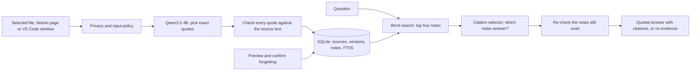

<div align="center">

# NEUROBRAIN
### Your notes. Evidence you can trace. Memory you control.

A research prototype for turning selected notes and approved on-screen observations into searchable, cited memory—with deliberate, verifiable forgetting.


[Get started](#get-started) · [How it works](#how-it-works) · [Evidence & evaluation](#evidence--evaluation) · [Project roadmap](#project-roadmap)

</div>

---

## Why NeuroBrain?

Useful information gets scattered across project notes, decisions, and personal preferences. Finding it again should come with a clear answer to three questions: **Where did this come from? Is it supported by my notes? Can I remove it?**

NeuroBrain explores that workflow through a small, inspectable system. Import selected Markdown or text files, retrieve exact passages with source references, and preview and verify the removal of a saved source.

> **Current checkpoint (27 Nov 2026):** a working local prototype. A selected Notion page, saved file or approved VS Code window → local Qwen3.5 extraction of exact quotes → versioned SQLite memory → a fine-tuned **citation selector** picks which stored note answers → Open WebUI shows that note word for word with its citation, or says it has no evidence. Live gates for hosted Supabase saving, screen OCR, Notion and Open WebUI [passed on 24 Nov](reports/demo_week/2026-11-24-hosted.md) on fictional data. Selector v2 [passed its sealed gate](reports/selector_v2/README.md); it can still cite an outdated line when a page records a change.

## What works today

| Capability | What you can do |
| --- | --- |
| **Selected note import** | Import permitted `.md` and `.txt` files from an explicitly allowed folder. |
| **Versioned memory** | Keep source history while searching current note versions; repeated imports are idempotent. |
| **Traceable retrieval** | Find exact excerpts with citations and source locations. Word search with stemming, question words dropped, and the top note's next note from the same page. |
| **Evidence-based responses** | Chat answers are stored quotes chosen by a model; it cannot write new text. Unsupported questions can get a no-evidence reply (not guaranteed). |
| **Optional hybrid search** | Add offline MiniLM retrieval (`NEUROBRAIN_HYBRID=1` for chat answers). Off by default: it [did not do better](reports/hybrid_v1/README.md). |
| **Controlled forgetting** | Preview source deletion, confirm it with a token, and receive a verification receipt. |
| **Two interfaces** | Explore the same memory services through the local browser UI or CLI. |
| **Observed input and extraction** | Read a selected file, a flat Notion page or an approved VS Code window (local OCR); local Qwen3.5 returns exact quotes with source, route, time and evidence spans, validated before saving. Long pages are read in windows, with a second pass over skipped sentences. |
| **Open WebUI bridge** | `neurobrain-memory` answers with cited excerpts from the same database; `--hosted` reads the signed-in Supabase rows instead. |
| **Cross-route linking** | A single-sentence fact seen on screen and then saved to its file shows as one logical note, and forgetting takes both. Multi-line files whose extracted quotes differ from the capture do not link yet. |
| **Import policy** | Reject unsupported, hidden, oversized, excluded, and obvious credential-containing notes. Credential detection is heuristic. |

## How it works



| Step | What does it | Trained here? |
|---|---|---|
| Extraction | Pretrained `qwen3.5:4b` in Ollama | No |
| Retrieval | SQLite FTS5 ([retrieval v1](reports/retrieval_v1/README.md)) | No |
| Answer selection | `neurobrain-selector-v2`, a QLoRA fine-tune of Qwen3.5 4B | Yes |
| Admission score (preview only) | Small MLP; a logistic baseline [still beats it](reports/admission_v2/report.json) | Yes, advisory |

The selector only returns citation IDs from the five notes it was shown. The app then shows those notes' own text. Selecting the wrong note is still possible.

## Get started

**Requirements:** Python 3.11 or newer with SQLite FTS5 support. The core uses only the standard library. The chat app also needs [Ollama](https://ollama.com) with `qwen3.5:4b`.

```bash
git clone https://github.com/Anm0l-17/NEUROBRAIN.git
cd NEUROBRAIN
gh repo clone yalongwastaken/git-koi
```

### Chat with your saved notes (one command)

Run these from the repository root. The start script serves the database of the checkout named by `ROOT` at its top, and the save command writes to the database of the folder you run it in, so both must be the same checkout. On a new machine, first set `ROOT` to your clone and create the interpreter the script expects:

```bash
python3 -m venv .venv
```

Save a note into the database (here a fictional demo file):

```bash
PYTHONPATH=src python3 -m neurobrain.observe --file examples/notes/project.md --save-extracted
```

Create a key for the chat bridge:

```bash
export NEUROBRAIN_CHAT_KEY="$(python3 -c 'import secrets; print(secrets.token_urlsafe(32))')"
```

Copy it for Open WebUI (macOS):

```bash
printf %s "$NEUROBRAIN_CHAT_KEY" | pbcopy
```

Start the bridge on port 8766:

```bash
scripts/start_prototype.sh
```

- **Selector model:** `NEUROBRAIN_SELECTOR_MODEL`, default `neurobrain-selector-v2`. The adapter weights are not in this repository; build the model with `scripts/deploy_selector.sh` from a trained adapter. Without it, start with `NEUROBRAIN_SELECTOR_MODEL=qwen3.5:4b scripts/start_prototype.sh` (weaker: see below).
- **Open WebUI:** add an OpenAI-compatible connection to `http://127.0.0.1:8766/v1` with the same key, then pick **`neurobrain-memory`**. Picking the raw Ollama model bypasses the memory entirely.
- Ask complete questions ("When is the violet demonstration?"). The bridge does not use chat history.

Other inputs (Notion page, VS Code window, hosted Supabase) are described in the [observation quickstart](docs/Observation_Quickstart.md) and [cloud setup](docs/Cloud_Setup.md).

### Model-free demo

```bash
PYTHONPATH=src python3 scripts/demo.py
```

The demo uses fictional notes and a temporary database. It checks import, duplicate handling, policy rejection, retrieval, unsupported-query behavior, and deletion across a restart.

### Browser interface and command line

```bash
PYTHONPATH=src python3 -m neurobrain import examples/notes/project.md
PYTHONPATH=src python3 -m neurobrain import examples/notes/preferences.txt
PYTHONPATH=src python3 -m neurobrain serve
```

Open **[localhost:8765](http://127.0.0.1:8765)**. This interface uses a separate database, `.neurobrain/memory.sqlite3`.

```bash
# Search for cited passages
PYTHONPATH=src python3 -m neurobrain search "SQLite"

# List saved sources and inspect the active import policy
PYTHONPATH=src python3 -m neurobrain sources
PYTHONPATH=src python3 -m neurobrain policy

# Hybrid retrieval; reports fallback if the encoder is unavailable
PYTHONPATH=src python3 -m neurobrain hybrid "database choice"
```

For your own notes, pass `--notes-root /absolute/path/to/notes` **before the command**. Only explicitly selected files inside that folder are eligible for import. Use `python3 -m neurobrain --help` with `PYTHONPATH=src` for all commands, including deletion preview and confirmation.

## Evidence & evaluation

All sets are small and mostly fictional or public-derived. They establish prototype behaviour, **not real-world accuracy or research superiority**.

| Recorded evaluation | Result | Interpretation |
| --- | --- | --- |
| [Selector v2, sealed set](reports/selector_v2/README.md) (291 rows) | Answerable exact 140/181 (unmodified model, same route: 96/181); abstain precision 0.870 | Passed the gate fixed before training; the precision margin is only three rows |
| [Selector v3, sealed gate](reports/selector_v3/README.md) (528 rows) | Current value 92/92 (v2: 46/92); real book club page 5/8, needed 6/8 and both dues | Failed 1 of 9 items; not promoted |
| [Live check](reports/live_check/README.md), 20 questions, stored notes, 26 and 27 Nov | v2 15/20; base Qwen 12/20; v3 17/20 (27 Nov, not deployed) | A spot check written after seeing the notes, not a sealed score. Three v2 misses cite outdated lines |
| [Extraction recall](reports/extraction_recall_v1/README.md), four locked pages | Facts kept 39/46 before the fix, 45/46 after | Nearly all of the gain is one encoding fix. The same live check on a re-extracted copy: v2 14/20 → 17/20 |
| [Retrieval v1](reports/retrieval_v1/README.md), 16 answerable questions | Answering note in the top five: 14/16 → 16/16 | Fixed set; a crowded store still loses one |
| [Hybrid retrieval](reports/hybrid_v1/README.md) | No gain; live check on new notes 17/20 → 15/20 | Stays off |
| [Live gates, 24 Nov](reports/demo_week/2026-11-24-hosted.md) | Supabase save/retry/second user/forget, screen OCR, Notion, Open WebUI passed | One fictional run each; a real network-drop test was not run |
| [Generator fine-tuning](reports/generator_pilot_v1/RESULTS.md) | Failed its gates; not deployed | Negative result |
| [Admission model](reports/admission_v2/report.json) | MLP loses to logistic regression | Advisory preview only; never decides what is saved |

Run the tests (108; tests needing torch are skipped without it):

```bash
PYTHONPATH=src python3 -m unittest discover -s tests
```

## Known limits

- The selector can cite an outdated line after an update ("dues are $5" after "dues went up to $8"). A newer selector (v3) fixes most of this on test data but [failed one of its nine gate items](reports/selector_v3/README.md), so the app still uses v2.
- Word search misses questions that share no word with the answering note.
- Extraction can still skip facts, differs a little between runs, and makes saving slower than the 5-second target on long pages.
- Chat questions that lean on history ("what about it?") are refused by a word-list guard that is sometimes wrong.
- Screen capture supports one approved VS Code window; pause/stop and revoked-permission cases are untested.

## Privacy & forgetting

- **Explicit selection:** the prototype accepts selected text and Markdown notes from the allowed folder.
- **Local by default:** notes and extraction stay on this machine (Ollama). Hosted saving to Supabase happens only with the explicit `--save-hosted` request and a signed-in account; nothing is used for training.
- **Inspectable evidence:** retrieved passages retain source references rather than relying on an unsupported generated answer.
- **Application-level deletion:** forgetting removes the selected source's stored versions and derived application data. The original note file remains intact.

Deletion does not erase backups, copied text, browser history, or old database copies. It is not forensic erasure or model unlearning. Review notes before importing; heuristic credential checks cannot detect every secret.

## Project roadmap

| Stage | Status |
| --- | --- |
| Local import, versioning, cited search, browser UI, and verified forgetting | Implemented |
| Notion, saved-file and screen-OCR extraction; Open WebUI answers | Implemented; live gates passed 24 Nov |
| Supabase PostgreSQL storage for observations | Passed hosted checks 24 Nov. Google Drive file import has no recorded hosted run |
| Fine-tuned citation selector | v2 deployed; v3 (newest fact) trained, not promoted |
| Offline MiniLM and hybrid retrieval | Optional; off by default |
| Memory admission dataset and model | Fictional data, draft labels; advisory only |
| Generator fine-tuning, temporal graph, Titans/Mamba, model unlearning, skill synthesis, forensic deletion | Future work |

## Explore the project

| Resource | Start here |
| --- | --- |
| System design | [Design v0.1](docs/System_Design_v0.1.md) · [Architecture diagram source](docs/NeuroBrain_Architecture.mmd) |
| Development plan | [Working plan](docs/NeuroBrain_Working_Plan.md) · [Session plan](docs/NeuroBrain_Session_Plan.md) |
| Annotation work | [Dataset overview](data/README.md) · [Annotation guide v1.2](docs/Admission_Annotation_Guide_v1_2.md) |
| Research reading | [22-paper research spreadsheet](outputs/01a1a787-93d4-7031-a06c-cf0b8e572393/NeuroBrain_22_Research_Papers.xlsx) |
| Implementation | [Application](src/neurobrain/) · [Scripts](scripts/) · [Tests](tests/) |
| Progress record | [Session log](reports/session_log.md) · [Finish plan](docs/Final_Plan_2026-11-30.md) · [Demo run sheet](docs/Prototype_Demo_Runbook.md) |

---

<div align="center">

**A research project in trustworthy personal memory: retrieve with evidence, retain with intent, forget with verification.**

</div>
