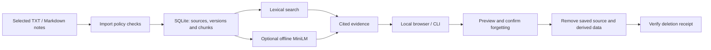

<div align="center">

# NeuroBrain
### Your notes. Evidence you can trace. Memory you control.

A local research prototype for turning selected notes into searchable, cited memory—with deliberate, verifiable forgetting.


[Get started](#get-started) · [How it works](#how-it-works) · [Evidence & evaluation](#evidence--evaluation) · [Project roadmap](#project-roadmap)

</div>

---

## Why NeuroBrain?

Useful information gets scattered across project notes, decisions, and personal preferences. Finding it again should come with a clear answer to three questions: **Where did this come from? Is it supported by my notes? Can I remove it?**

NeuroBrain explores that workflow through a small, inspectable system. Import selected Markdown or text files, retrieve exact passages with source references, and preview and verify the removal of a saved source.

> **Current checkpoint:** a working local prototype with a browser interface, command-line tools, SQLite search, and optional offline hybrid retrieval. Cloud integration and learned memory admission remain research work.

## What works today

| Capability | What you can do |
| --- | --- |
| **Selected note import** | Import permitted `.md` and `.txt` files from an explicitly allowed folder. |
| **Versioned memory** | Keep source history while searching current note versions; repeated imports are idempotent. |
| **Traceable retrieval** | Find exact excerpts with citations and source locations. |
| **Evidence-based responses** | Use extractive answers and receive a no-evidence response for unsupported queries. |
| **Optional hybrid search** | Combine lexical and offline MiniLM retrieval, with explicit lexical fallback when the model is unavailable. |
| **Controlled forgetting** | Preview source deletion, confirm it with a token, and receive a verification receipt. |
| **Two interfaces** | Explore the same memory services through the local browser UI or CLI. |
| **Import policy** | Reject unsupported, hidden, oversized, excluded, and obvious credential-containing notes. Credential detection is heuristic. |

## How it works



The default path uses SQLite full-text search and extracts evidence from stored notes. The optional semantic experiment loads a pinned `all-MiniLM-L6-v2` encoder from the local model cache. It does not generate answers or train on your notes.

## Get started

**Requirements:** Python 3.11 or newer with SQLite FTS5 support. The core prototype uses the Python standard library; optional ML experiments require their own dependencies and cached model files.

```bash
git clone https://github.com/Anm0l-17/NEUROBRAIN.git
cd NEUROBRAIN
```

### 1. Run the guided demo

```bash
PYTHONPATH=src python3 scripts/demo.py
```

The demo uses fictional notes and a temporary database. It checks import, duplicate handling, policy rejection, retrieval, unsupported-query behavior, and deletion across a restart.

### 2. Open the browser interface

```bash
PYTHONPATH=src python3 -m neurobrain import examples/notes/project.md
PYTHONPATH=src python3 -m neurobrain import examples/notes/preferences.txt
PYTHONPATH=src python3 -m neurobrain serve
```

Open **[localhost:8765](http://127.0.0.1:8765)**. The example notes are fictional; saved application data defaults to `.neurobrain/memory.sqlite3`.

### 3. Explore from the command line

```bash
# Search for cited passages
PYTHONPATH=src python3 -m neurobrain search "SQLite"

# Request an extractive response
PYTHONPATH=src python3 -m neurobrain ask "SQLite"

# List saved sources and inspect the active import policy
PYTHONPATH=src python3 -m neurobrain sources
PYTHONPATH=src python3 -m neurobrain policy

# Try optional hybrid retrieval; reports fallback if unavailable
PYTHONPATH=src python3 -m neurobrain hybrid "database choice"
```

For your own notes, pass `--notes-root /absolute/path/to/notes` **before the command**. Only explicitly selected files inside that folder are eligible for import. Use `python3 -m neurobrain --help` with `PYTHONPATH=src` for all commands, including deletion preview and confirmation.

## Evidence & evaluation

The repository includes reproducible checks and small fictional evaluation sets. These establish prototype behavior, **not real-world accuracy or research superiority**.

| Recorded evaluation | Result | Interpretation |
| --- | --- | --- |
| [Lifecycle baseline](reports/baseline_v0.json) | Recorded gate passed | Checks retrieval, unsupported-query abstention, citations, and selective deletion on a small fictional corpus. |
| [Semantic experiment](reports/semantic_v0.json) | Lexical and semantic Recall@5 both 1.0 across two cases | Confirms the retrieval path works; does not demonstrate a semantic improvement. |
| [Admission pilot](data/README.md) | 80 fictional examples with versioned draft labels | Annotation and consistency work; the pilot does not control real note storage. |

Run the core tests and baseline evaluation:

```bash
PYTHONPATH=src python3 -m unittest discover -s tests
PYTHONPATH=src python3 scripts/evaluate_baseline.py --output reports/baseline_v0.json
```

Optional semantic evaluation, using an environment with the required dependencies and pinned model already cached:

```bash
PYTHONPATH=src .venv/bin/python scripts/evaluate_semantic.py --output reports/semantic_v0.json
```

See the [verification report](reports/verification.md), [pilot review](reports/admission_pilot_review_2026-11-06.md), and [repeat review](reports/admission_pilot_repeat_2026-11-06.md) for context and limitations.

## Privacy & forgetting

- **Explicit selection:** the prototype accepts selected text and Markdown notes from the allowed folder.
- **Local processing:** the current local prototype does not upload notes or use them for training.
- **Inspectable evidence:** retrieved passages retain source references rather than relying on an unsupported generated answer.
- **Application-level deletion:** forgetting removes the selected source's stored versions and derived application data. The original note file remains intact.

Deletion does not erase backups, copied text, browser history, or old database copies. It is not forensic erasure or model unlearning. Review notes before importing; heuristic credential checks cannot detect every secret.

## Project roadmap

| Stage | Status |
| --- | --- |
| Local import, versioning, cited search, browser UI, and verified forgetting | Implemented |
| Offline MiniLM and hybrid retrieval | Implemented as an optional experiment; broader evaluation needed |
| Memory admission dataset and annotation rules | Fictional pilot under review; labels remain drafts |
| Google Drive originals + Supabase application data | Design and schema prepared; integration not implemented |
| Generated answers, temporal reasoning, and automatic learned admission | Future work |

The local SQLite implementation remains the reference while the planned cloud version works toward feature parity. See the [cloud setup and implementation plan](docs/Cloud_Setup.md).

## Explore the project

| Resource | Start here |
| --- | --- |
| System design | [Design v0.1](docs/System_Design_v0.1.md) · [Architecture diagram source](docs/NeuroBrain_Architecture.mmd) |
| Development plan | [Working plan](docs/NeuroBrain_Working_Plan.md) · [Session plan](docs/NeuroBrain_Session_Plan.md) |
| Annotation work | [Dataset overview](data/README.md) · [Annotation guide v1.1](docs/Admission_Annotation_Guide_v1_1.md) |
| Research reading | [22-paper research spreadsheet](outputs/01a1a787-93d4-7031-a06c-cf0b8e572393/NeuroBrain_22_Research_Papers.xlsx) |
| Implementation | [Application](src/neurobrain/) · [Scripts](scripts/) · [Tests](tests/) |
| Progress record | [Session log](reports/session_log.md) |

---

<div align="center">

**A research project in trustworthy personal memory: retrieve with evidence, retain with intent, forget with verification.**

</div>
