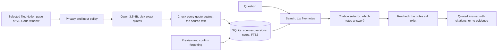

# NeuroBrain: a local-first personal memory assistant with cited evidence

Minor project report. **Draft of 27 November 2026.**

*[To fill in: author, roll number, department, guide, college. Required template and page limit not yet confirmed.]*

*Status of this draft: updated 27 November with the citation selector v3 results. Numbers cite the file they come
from; the single evaluation table (`reports/Final_Evaluation_2026-11.md`) is still to be assembled.*

---

## Abstract

Personal facts are scattered across notes, pages and screens, and a language model asked about them can answer
fluently and wrongly. NeuroBrain is a local-first assistant that stores only **exact quotes** from sources the
user selects (a text file, a Notion page, or an approved editor window read by local OCR), keeps their source and
version, and answers a question only by **showing stored quotes with citations**, or by saying that it has no
evidence. The user can preview and then delete a saved source and receive a receipt.

A pretrained 4-billion-parameter model (Qwen 3.5 4B) extracts the quotes. We fine-tuned the same model with
QLoRA as a **citation selector**, which chooses which of five retrieved notes answers the question. On a sealed
set of 291 examples, with a promotion gate fixed before training, the second version raised exact matches on
answerable questions from 96/181 (unmodified model, same serving route) to 140/181, with abstention precision
0.870, and passed. It still tends to cite an outdated line when a page records a change. A third version, trained to
prefer the current value, was far better at this on sealed template examples (92/92 against 46/92) but passed only
eight of its nine pre-set gate items, missing the one on a real page (5 of 8), so the second version stays in use.

Two other training efforts gave negative results: a small model that scores which text is worth remembering did
not beat logistic regression, and a small generator fine-tune failed its attribution tests. Both are reported.
All evaluations are small; they describe a working prototype, not general accuracy.

## 1. Problem and objectives

A memory assistant should let its user answer three questions about anything it says: **Where did this come
from? Is it supported by my notes? Can I remove it?** A chatbot that has absorbed notes into its weights, or that
writes free text over retrieved passages, answers none of them reliably.

Objectives of this mini-project:

1. Take in only sources the user explicitly selects, on the user's machine by default.
2. Store verifiable evidence: exact text, source, position, time and version.
3. Answer with cited evidence, or abstain.
4. Delete a source and everything derived from it inside the application, with a receipt.
5. Train at least one component, and judge it against a baseline with a rule fixed in advance.

The original vision (`NEUROBRAIN.md`) was wider: test-time weight adaptation, state-space working memory, an
associative graph, autonomous skill synthesis and model unlearning. These were left out of the first release
(`docs/NeuroBrain_Working_Plan.md`) and none of them is claimed here.

## 2. Related work

Twenty-two papers were reviewed (`NeuroBrain_22_Paper_Literature_Review.md`, 16 October 2026). Results quoted
there are those of each paper in its own setting. Two entries (10 and 11) are versions of one manuscript, and four
(2, 7, 21, 22) had too little accessible detail to support a performance claim.

**Long-term agent memory.** A review argues that agent memory needs types and a life cycle rather than a larger
vector store [1]. Several systems keep structured episodic records with provenance: event frames and a temporal
graph [3], filtering before storage, which cut token use while mostly keeping quality [4], topic-level
consolidation with a reranker that learns from citation feedback [6], temporal knowledge graphs [7, 19, 22],
persona graphs [2] and tiered compression on small devices [17]. A survey of graph memory warns that "newest
wins" is not enough, because correction, replacement and coexistence differ [18].

**Continual adaptation.** Protected low-rank experts can adapt a model with little forgetting in classification
benchmarks [5], at the cost of complexity, and changing weights makes later deletion harder to guarantee.

**Forgetting and privacy.** Approximate unlearning methods have been shown mainly on image classifiers and
federated settings [8–11, 21]. A privacy benchmark finds that failing to recall something is not proof it is gone
[12].

**On-device models.** Surveys and measurements show quantization is usually the first useful compression step and
that results depend on hardware and runtime [13–15]. Small local models can route intents [16] and orchestrate
tools on narrow tasks [20].

**What we took from this.** Keep memory **outside** the model weights, keep provenance and versions, treat
admission as a separate decision under hard privacy rules, make deletion a cascade through stored data that is
tested, and claim only deletion, not unlearning.

## 3. System design

### 3.1 Pipeline

| Component | Implementation |
|---|---|
| Input policy | Allowed folder only; hidden, excluded and linked paths refused; UTF-8, at most 1 MiB; refuses a `neurobrain: do-not-store` line and obvious credentials (a heuristic) |
| Inputs | Selected TXT/Markdown file; a flat Notion page through its API; one approved VS Code window via local OCR, checked before and after capture |
| Extraction | `qwen3.5:4b` in Ollama, schema-constrained output |
| Storage | SQLite: `sources` (versioned), `chunks`, FTS5 index, `observation_metadata`, `tombstones`, `deletion_receipts`. Supabase PostgreSQL as an optional hosted store |
| Retrieval | FTS5 word search |
| Answering | Citation selector, then a re-check |
| Interfaces | Command line, local web page, OpenAI-compatible bridge for Open WebUI |

### 3.2 Evidence guarantees

- **Exact quotes only.** A note is stored only if its text occurs in the source (matched literally, ignoring case as
  a fallback); the stored text is the source's own span with character and line positions. A reworded quote is
  dropped.
- **Checked twice.** Saving repeats the check, including the source hash and offsets, so a caller cannot insert
  unverified text.
- **The selector cannot write.** It returns identifiers constrained to the notes it was shown. Replies show the
  stored text. Unknown identifiers are rejected.
- **Re-check before delivery.** The search is repeated after the model replies, and again by the chat bridge before
  sending, so a note deleted in between is not shown.

These guarantee where the text came from. They do **not** guarantee that the note chosen is the right or the
current one.

### 3.3 Extraction

Long pages are read in windows of about 600 characters, cut at sentence ends, because one call on a long
paragraph stopped partway. Acknowledgments and short sentences that lean on unnamed references ("Move that to
there…") are filtered out. After the first call on a window, a second call sees only the sentences that no quote
covered (section 5.3).

### 3.4 Retrieval

Search uses stemming, drops question words, and gives the last of five slots to the note that follows the best
match on the same page, since the next note often completes it without sharing a word. An optional hybrid with a
MiniLM encoder (reciprocal rank fusion) can be switched on; it is off by default (section 5.4).

### 3.5 Forgetting

The user previews a deletion, then confirms it with a token that becomes stale if the data changed. All versions of
the source, linked copies and sibling screen captures are removed; their content hashes are tombstoned against
re-import; the search index is merged so deleted terms do not remain in old segments; a receipt is stored. Older
versions are never brought back as current. This is **application-level deletion**. It does not erase the original
file, backups, copies in the chat client's history, or anything from model weights.

## 4. Data and training

Only fictional text and public research data were used to train. The user's notes are never training data.

### 4.1 Citation selector

**Task.** Input: a question and up to five evidence lines with identifiers, in exactly the request format the app
sends. Output: the identifiers of the lines that answer, or an empty list.

**Sources.** SQuAD 2.0 [S1] (includes unanswerable questions), HotpotQA [S2] (needs several lines),
LongMemEval [S3] (conversation memory), and a few hand-written demo fixtures. SQuAD and HotpotQA rows carry
CC BY-SA 4.0; LongMemEval is MIT (`data/selector_v2/NOTICE.md`). Splits are built so that sealed rows do not share
questions or evidence lines with training rows (fixtures excepted).

**Training.** Qwen 3.5 4B (pinned revision), 4-bit NF4, LoRA [S4, S5] of rank 16 on the language model's attention
and feed-forward projections (about 30.5 M trainable parameters), learning rate 2e-4, gradient accumulation 8, one
epoch, seed 17, one Kaggle Tesla T4 (`kaggle/selector_train.py`).

**Serving.** The adapter is merged, converted to GGUF, quantized to Q4_K_M and loaded into Ollama
(`scripts/deploy_selector.sh`). Conversion alone changes behaviour, so every adapter is compared with the
**converted base**: the unmodified model taken through the same route. A rehearsal with a zero adapter produced a
byte-identical file and identical answers on 30 rows.

**Gate.** Before each result existed, a pass rule was written: floors for abstention recall and precision, answerable
exact match within 0.02 of the converted base (or better), all answerable demo fixtures and at least five of six
near-miss fixtures, and no errors.

| Version | Training rows (empty targets) | Optimizer steps, time | Outcome |
|---|---|---|---|
| v1 | 3,000 (36%) | 375, 7,208 s | **Failed**: refused too often |
| v2 | 2,808 (20%) | 351, 7,944 s | **Passed**, deployed |
| v3 | 3,676 (19.9%) | 459, 13,445 s | **Failed** one of nine items; not deployed as default |

**v1.** Abstain precision 0.571 (needed 0.85) and answerable exact 122/237, one row below the bar. It returned
nothing on 90 of 237 answerable rows (`reports/selector_v1/README.md`). The cause was in the data: too many empty
targets in the SQuAD share and no conversation-style evidence in training.

**v2** changed only the data. Results are in section 5.1.

**v3** targets a fault seen in the running app: asked how much the dues are, v2 cites "Dues are $5 a month" although
a later line says they went up to $8. v2 had never trained on an old and a new value side by side. v3 adds such rows,
with the current line as the only correct citation, plus counter-examples (an unchanged attribute, a question about
the original value, an absent attribute) so that the model cannot simply prefer lines with change words. The sealed
update set uses attribute families and names that never appear in training. Four further gate items cover current-value
accuracy (at least 69/92), citing an outdated line (at most 28/115), the book club fixtures, and the counter-examples
(`reports/selector_v3/README.md`). Results are in section 5.1.

### 4.2 Memory admission model (negative result)

A classifier meant to suggest what is worth remembering: a frozen MiniLM embedding [S6] plus four metadata features,
then layers 388 → 128 → 32 → 1. Data: 1,584 fictional records labelled and reviewed in batches (960 keep, 528 skip,
96 uncertain), later joined by 4,004 turns from LoCoMo [S7] with labels derived from model-generated observations.

| Train on | Test on | MLP average precision | Logistic regression |
|---|---|---|---|
| Own data (1,422) | Own (48) | 0.730 | **0.806** |
| Own data | LoCoMo (1,198) | 0.453 | **0.531** |
| LoCoMo + own | Own | 0.797 | **0.851** |
| LoCoMo + own | LoCoMo | 0.584 | **0.638** |

(`reports/admission_v2/report.json`.) More data helped the neural model, but logistic regression on the same
embeddings won every comparison. The own-data splits come from only three template families, and the test sets are
small. The model therefore only offers a preview score and **never decides what is saved**.

### 4.3 Generator adaptation (negative result)

We also tried small LoRA adapters that write grounded answers while keeping track of **who** said what.

| Experiment | Base | Adapter | Decision |
|---|---|---|---|
| Local pilot, repaired adapter, 9 development cases | 4/9 | 7/9 (equal to the earlier adapter, different failures) | Failed |
| Kaggle compact adapter, 9 development cases | 6/9 | 8/9 | Failed (required 9/9): gave a film character's vineyard to the user |
| Same adapter, expanded instruction, 6 new probes | 4/6 | 4/6, with a new attribution error | Not promoted |

(`reports/generator_pilot_v1/RESULTS.md`, `reports/compact_kaggle_v1/RESULTS.md`,
`reports/attribution_followup/RESULTS.md`.) The sets are tiny and hand-written. We stopped here and made the product
design avoid generated text altogether: the app quotes stored notes.

## 5. Evaluation

### 5.1 Selector, sealed gate (v2 sealed set, 291 rows)

| Model | Exact | Answerable exact | Abstain recall | Abstain precision | Errors |
|---|---|---|---|---|---|
| Converted base | 0.433 | 96/181 (0.530) | 0.273 | 1.000 | 0 |
| Adapter v1 (reference) | 0.739 | 107/181 (0.591) | 0.982 | 0.671 | 0 |
| **Adapter v2** | **0.780** | **140/181 (0.773)** | 0.791 | 0.870 (87/100) | 0 |

(`reports/selector_v2/README.md`.) v2 also passed 9/9 answerable and 6/6 near-miss fixtures. The precision margin is
three rows. Conversation-style refusals are the weakest area, on a 30-row slice.

**v3 against its nine-item gate** (`reports/selector_v3/README.md`). On the new 261-row sealed set it scored 114/142
answerable exact (v2: 112), abstain recall 0.908 and precision 0.923, with no errors. On the 267-row update set:

| Model | Current value exact | Outdated line cited | Book club fixtures (dues) |
|---|---|---|---|
| Converted base | 26/92 | 82/115 | 1/8 (0/2) |
| Adapter v2 | 46/92 | 61/115 | 2/8 (0/2) |
| Adapter v3 | **92/92** | **6/115** | **5/8 (1/2)** — needed 6/8 and 2/2 |

v3 passed items 1 to 7 and item 9 and **failed item 8**. By the rule fixed in advance it was not promoted, although it
is as good as or better than v2 on every other update measure. The gap between 92/92 on template rows and 5/8 on the real page
suggests the templates are easier than real writing. During training the notebook's own development score showed 141
unreadable replies of 386; a replay of 20 of those rows on the served model gave 20 readable replies, and the sealed
runs had none. The cause on the training machine was not established.

### 5.2 End-to-end spot check

Twenty questions (13 answerable, 7 with no answer in the notes) about a fictional book club page saved from Notion,
asked through the app on a copy of its database (`reports/live_check/README.md`). The questions were written after
seeing the notes, so this is a regression check, not an unbiased score.

| Selector | Notes as stored on 26 Nov | Same page, re-extracted with the final code |
|---|---|---|
| Unmodified `qwen3.5:4b` | 12/20 | 14/20 (13/20 on one repeat on 26 Nov) |
| Selector v2 | 15/20 | **17/20** |
| Selector v3 (not promoted) | 17/20 | 17/20 |

The right-hand column uses the retyped page text (`reports/extraction_recall_v1`); the same text extracted with the old
code scored 14/20 with v2. On the re-extracted page v2 misses two dues questions, where it cites the outdated line, and
a fee the page never states. v3 fixes one dues question and instead cites the outdated reading chapter, so the two tie
there. The 27 November runs were repeated with identical citations.

### 5.3 Extraction recall

Two facts on the test page were never stored. Three causes were found in the model's output: text sent as escaped
ASCII made "Café" come back as "Cafè"; quotes were rewritten; and sentences were skipped. After the fix
(`reports/extraction_recall_v1/README.md`):

| Set | Old code | Final code |
|---|---|---|
| Four locked pages, written before any variant ran (46 facts) | 39 | **45** |
| Seven development pages (79 facts; these shaped the fix) | 70–71 (an earlier run, file not kept, gave 65) | 79 |

On the locked pages the one-line encoding fix alone also reached 45; the prompt change and second pass were needed for
the book club page. Total extraction time rose by 30% on the locked pages and about 6% on the development pages. Eleven scripted lifecycle fixtures (F01–F11,
including the vague-sentence case F07) passed; Notion and OCR are simulated in that script.

### 5.4 Retrieval

On a fixed set of 16 answerable questions, stemming, stopword removal and the next-note rule raised "answering note in
the top five" from 14/16 to 16/16, with 6/6 near misses still refused (`reports/retrieval_v1/README.md`). With extra
distracting notes, one question still drops out.

The encoder hybrid was **not better** (`reports/hybrid_v1/README.md`): equal on the fixed set and on the stored notes
(15/20), worse on the re-extracted notes (15/20 against 17/20). It also adds a few seconds on the first question and
raises memory from about 26 MB to about 500 MB. It is available but off.

### 5.5 Live integration checks (24 November, fictional data)

Hosted Supabase signed-in save, retry without duplication, search from a fresh process, isolation from a second user,
and forgetting; screen OCR, including refusal when another app was in front; Notion preview, save, update and
version replacement; and cited and no-evidence answers in Open WebUI all passed
(`reports/demo_week/2026-11-24-hosted.md`). Each was a single run. A real network drop during a hosted write was not
tested.

### 5.6 Software tests

108 automated tests pass on the development Mac (26 November); some are skipped where the optional libraries are
missing. They cover import policy, versioning, exact spans, forgetting, citation checks, the chat bridge, retrieval
and extraction handling, mostly with stand-ins for the models. **[Final count to be recorded on the submitted
code.]**

## 6. Limitations

- **Evaluation size.** Sets are small, several were written by the project itself, and some were used to shape fixes.
  Single runs of the extraction and base models vary between runs.
- **Updates.** The app has no notion of time or replacement; preferring the newest statement is left to the selector,
  and the deployed selector (v2) often picks the older one.
- **Retrieval.** A question sharing no word with its answering note can miss it.
- **Extraction.** It can skip facts, and saving long pages takes tens of seconds.
- **Abstention** is not guaranteed; a related but non-answering note can be cited.
- **Input scope.** Flat Notion pages and one editor window. Pause/stop and revoked screen permission were not tested.
- **Privacy.** Credential detection is a pattern heuristic. Deletion is not forensic and does not cover backups, chat
  history or per-passage removal.
- **Deployment.** Single user, one Mac; the start script assumes its paths.

## 7. Future work

Temporal facts (validity intervals and explicit supersession); synonym-aware or stronger retrieval with a relevance
cut-off; per-passage forgetting and forensic deletion; a larger independently written evaluation set; a trained
abstention check for extraction; an admission model on independently sourced data; and, only after measured need,
parametric adaptation with attack-based unlearning tests. Generator fine-tuning, Titans/Mamba-style memory and skill
synthesis remain research directions.

## 8. Conclusion

A useful, inspectable personal memory can be built around frozen weights: the model chooses, the database holds the
facts, and the user sees the original words and can remove them. The one fine-tune that was promoted solves a narrow
task with a rule set in advance; the other two training efforts fell short and decide nothing in the product. The main open fault is choosing
current over outdated information. Training on update examples reduced it sharply on sealed template data, but not
yet enough on the real page to meet the bar, so it remains open in the deployed system.

## References

Papers 1–22 as verified in `NeuroBrain_22_Paper_Literature_Review.md`:

1. Hatalis et al. Memory Matters: The Need to Improve Long-Term Memory in LLM-Agents. *AAAI Symposium Series* 2(1), 2024.
2. De Marco et al. Development of a Human-inspired Long-Term Memory for Interactive Conversational Agents. IEEE MetroXRAINE, 2025.
3. Lu et al. Structured Episodic Event Memory. ACL, 2026.
4. Lan et al. EMA: An Episodic Memory Agent for Efficient and Selective Memory. Findings of ACL, 2026.
5. Qiu et al. MINGLE: Mixture of Null-Space Gated Low-Rank Experts for Test-Time Continual Model Merging. NeurIPS, 2025.
6. Tan et al. In Prospect and Retrospect: Reflective Memory Management for Long-term Personalized Dialogue Agents. ACL, 2025.
7. Taha and Conway. LLM Agnostic Query Response Personalization via Temporal Knowledge Graph Database. IEEE NAECON, 2026.
8. Chen et al. Private Data Protection With Machine Unlearning for Next-Generation Networks. *IEEE Open Journal of the Communications Society* 6, 2025.
9. Rizwan et al. Fast and Accurate Class-Level Machine Unlearning using Impair–Repair and Noise-Induced Forgetting Mechanisms. *Cognitive Computation* 18, 2026.
10. Zhao et al. AdaProb: Efficient Machine Unlearning via Adaptive Probability. arXiv:2411.02622v3, 2026.
11. Zhao et al. Pseudo-Probability Unlearning (earlier version of [10]). arXiv:2411.02622v1.
12. Qian et al. Towards Benchmarking Privacy Vulnerabilities in Selective Forgetting with Large Language Models. AAAI, 2026.
13. Chen et al. On-device Large Language Models: A Survey of Model Compression and System Optimization. *Artificial Intelligence Review* 59, 2026.
14. Song et al. A Systematic Evaluation of On-Device LLMs: Quantization, Performance, and Resources. arXiv:2505.15030, 2026.
15. Tan et al. MobileQuant: Mobile-friendly Quantization for On-device Language Models. Findings of EMNLP, 2024.
16. Dubiel et al. On-device Query Intent Prediction with Lightweight LLMs to Support Ubiquitous Conversations. *Scientific Reports* 14, 2024.
17. Chang and Ren. ScrapMem: A Bio-inspired Framework for On-device Personalized Agent Memory via Optical Forgetting. arXiv:2605.03804, 2026.
18. Nguyen et al. Graph-Based Personalized Memory for LLM Agents: Representation, Evolution, Retrieval, and Evaluation. arXiv:2609.08599, 2026.
19. Sarabadani and Tajvidiyan. DYNA: Dynamic Episodic Memory Networks for Augmenting Large Language Models with Temporal Knowledge Graphs in Continuous Learning. arXiv:2606.15778, 2026.
20. Fu et al. CAMPHOR: Collaborative Agents for Multi-input Planning and High-Order Reasoning On Device. REALM workshop at ACL, 2025.
21. Wang et al. Federated Meta Unlearning Based on Model Decomposition and Weighted Aggregation. *Scientia Sinica Informationis* 55(11), 2025.
22. Luo et al. TAPE: A Temporal Graph-Based Memory System for Personal LLM Agents. ICDE demo, 2026.

Datasets and methods used directly *(not part of the verified review; check these entries before submission)*:

- [S1] Rajpurkar, Jia and Liang. Know What You Don't Know: Unanswerable Questions for SQuAD. ACL, 2018.
- [S2] Yang et al. HotpotQA: A Dataset for Diverse, Explainable Multi-hop Question Answering. EMNLP, 2018.
- [S3] Wu et al. LongMemEval: Benchmarking Chat Assistants on Long-Term Interactive Memory. ICLR, 2025.
- [S4] Hu et al. LoRA: Low-Rank Adaptation of Large Language Models. ICLR, 2022.
- [S5] Dettmers et al. QLoRA: Efficient Finetuning of Quantized LLMs. NeurIPS, 2023.
- [S6] Wang et al. MiniLM: Deep Self-Attention Distillation for Task-Agnostic Compression of Pre-Trained Transformers. NeurIPS, 2020.
- [S7] Maharana et al. Evaluating Very Long-Term Conversational Memory of LLM Agents (LoCoMo). ACL, 2024.
