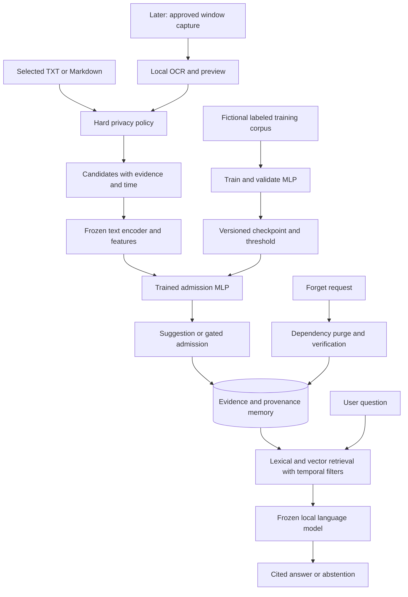
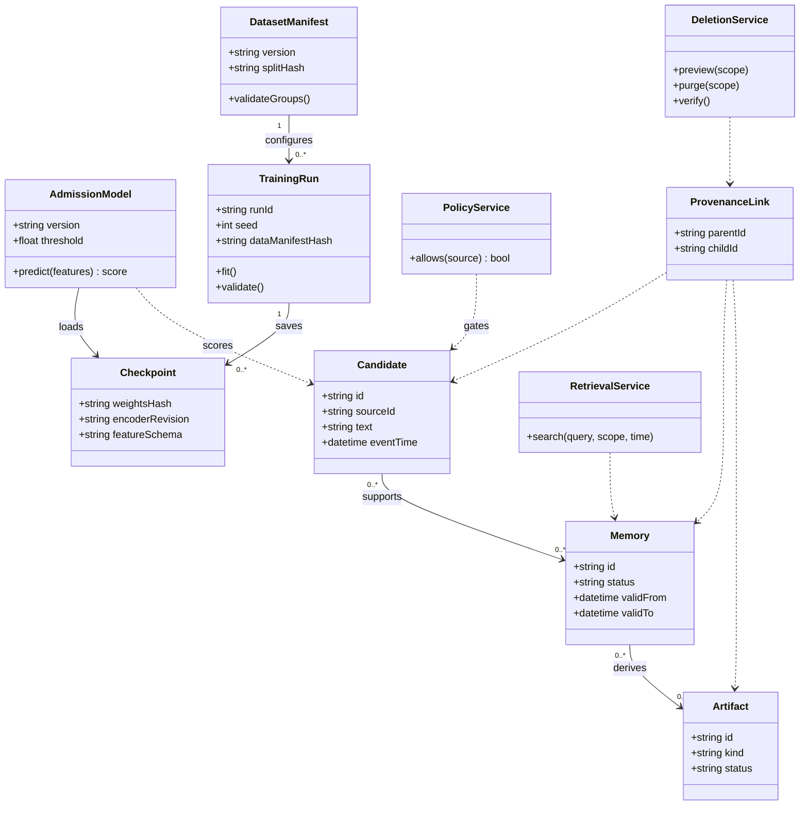

# NeuroBrain: complete session-by-session development and neural training plan

**Revision:** 27 October 2026. **Status:** authoritative full-project schedule; first deterministic application checkpoint implemented, datasets and trained checkpoints outstanding. This document supersedes the execution schedule in `NeuroBrain_Working_Plan.md`. That document remains background context, not a second competing schedule.

**Implementation update, 2 November 2026:** a first deterministic CLI/web baseline is implemented locally. The next prototype stage is a cloud storage path using Google Drive for original notes and Supabase PostgreSQL for evidence, while SQLite remains the tested reference backend. Training data, neural checkpoints, embeddings, generation, cloud integration and full release gates remain outstanding. The presentation checkpoint brings forward parts of sessions 17–24 and 43–44; it does not mark their prerequisite stages complete.

**Generator candidate update, 6 November 2026:** evaluate the locally trialled `qwen3.5:4b` as the first frozen, quantized answer generator. Its image input may also be useful in the later screen extension, but the core remains text-first. This is a candidate choice, not a completed integration or quality claim. Before selecting it for release, compare it with `qwen3:4b` on the same cited-note questions and bounded context; record answer support, abstention, cold/warm latency, peak RAM and offline behavior. Keep the retrieval-only fallback if generation misses these gates. The admission MLP remains the only model trained for v1.

## 1. Project outcome and neural contribution

Build a local notes-memory assistant with a small neural network trained by us to predict whether a candidate observation is useful as long-term memory. Combine it with inspectable evidence storage, temporal retrieval, cited answers and provenance-aware deletion. Extend to screen observations after the core passes its release gates.

The neural experiment has a defined input, labels, architecture, loss, training/validation/test protocol, baselines, checkpoints, inference interface and downstream evaluation. It is a genuine supervised neural-network component. It is not a newly trained foundation model, a neural database or a Titans-style test-time learning system.

### What is trained and what is frozen

| Component | Treatment | Purpose |
|---|---|---|
| Memory-admission MLP | Randomly initialize and train its approximately 54k parameters | Predict usefulness of a candidate memory |
| MiniLM text encoder | Pretrained and frozen | Convert text to a 384-dimensional vector |
| Local language model | Pretrained, quantized and frozen | Generate source-grounded answers |
| SQLite, FTS and temporal relations | Ordinary application data structures | Store, retrieve, correct and delete evidence |
| Optional screen OCR/vision | Start with pretrained local tools; no training requirement | Turn an approved screen observation into text |

Training inputs must be fictional, explicitly reusable data. Private user notes are inference inputs only. This keeps deleting a private note from application storage separate from removing its influence from trained weights.

### Core user journey

Select TXT/Markdown notes → policy check → parse/chunk → score usefulness → inspect or automatically admit according to mode → store evidence and derived indexes → ask questions → retrieve valid evidence → answer with citations or abstain → correct or forget a memory → verify cleanup after restart.

Initially use the learned score as a recommendation. Enable automatic exclusion only if its validation and downstream quality gates pass. Explicit “remember this” bypasses the usefulness score, but never privacy restrictions. Explicit “do not store” overrides every model output.

### Planning assumptions and scope

Earlier chats selected a solo developer, 8–16 GB laptop, notes/Markdown, CLI + web, memory + deletion, and 6–10 hours weekly. This request adds neural training and a much more detailed schedule. The old eight-week/60-hour budget does not cover the expanded work responsibly.

**Core:** 60 sessions × 2 focused hours = 120 hours. At four sessions weekly this is 15 weeks. Reserve 24 additional hours for annotation/bug-fix overruns: approximately 18 weeks at eight hours/week, or 15–24 weeks at 10–6 hours/week. Screen extension: 12 more sessions/24 hours. Foundational Python/neural learning may add 12–24 hours if these subjects are new. Model downloads and machine training time are additional elapsed time; measure them rather than assuming a GPU.

Sessions are work units, not guaranteed completion deadlines. If an exit test fails, repeat the affected work and use contingency. Never advance a privacy/correctness gate merely because the calendar moved forward. No production app code or model training is authorized by this planning deliverable alone.

## 2. Stage map and recurring session method

| Stage | Sessions | Focused hours | Gate |
|---|---|---:|---|
| A | 01–06 | 12 | Scope, foundations, machine and design ready |
| B | 07–16 | 20 | Labeled, validated, leakage-controlled datasets ready |
| C | 17–24 | 16 | Working deterministic memory/deletion baseline |
| C2 | next | focused prototype slice | Cloud import/storage parity with the local baseline |
| D | 25–36 | 24 | Neural training, selection and model report complete |
| E | 37–46 | 20 | Neural admission integrated with local assistant |
| F | 47–54 | 16 | Held-out, privacy, failure and performance testing complete |
| G | 55–60 | 12 | Reproducible release and academic submission |
| H, extension | 61–72 | 24 | Screen observation path evaluated and demonstrated |

For every two-hour session: review the previous artifact and prerequisite for 10 minutes; study/plan for 15; implement/annotate/run experiments for 70; verify for 20; record results and next actions for five. Training sessions can use the implementation block for machine runs and error analysis; do not silently exceed the time budget.

Keep `reports/session_log.md` with session ID/date, objective, actual hours, input versions, work completed, commands/config references, observed metrics/errors, exit-test result, unresolved items and next prerequisite. Never put raw private contents in logs. Every stage ends with a planning review that can reduce features or extend time using actual evidence.

## 3. Research questions and acceptance policy

**RQ1:** Does a trained admission classifier reduce indexed data without materially reducing answer quality compared with storing all permitted inputs?

**RQ2:** Does it outperform rules and logistic regression at the same useful-memory recall or storage budget?

**RQ3:** Do hybrid retrieval and temporal facts improve source-grounded and changed-fact answers?

**RQ4:** Can provenance-aware deletion remove application-controlled evidence and derived artifacts while preserving unrelated utility?

A negative result is valid. If the MLP is worse than logistic regression or unsafe for automatic omission, deliver its evaluated experiment and keep it in suggestion mode. Do not claim the neural component improved memory without controlled evidence.

Engineering targets, to freeze by session 06 before held-out evaluation:

- Admission validation: useful-memory recall ≥0.95, with precision, confusion matrix and confidence interval reported. To enable automatic exclusion also require ≥10% index reduction and ≤3 percentage-point downstream answer-quality drop against store-all on paired evaluation. These are project targets, not known results.
- Custom answerable QA: evidence Recall@5 ≥0.85 and answer correctness ≥0.80; citation support ≥0.95; unsupported-question abstention ≥0.90. Record counts and false abstentions.
- Deletion: all defined structural/lifecycle cases pass, with zero access to deleted evidence or synthetic canaries in exact/paraphrased/related probes after restart. This is a finite-suite guarantee, not universal privacy proof.
- Retained answers: no more than five percentage points degradation on the predefined unaffected question set; small counts require cautious interpretation.
- Offline: all core flows work with external network blocked after assets are cached.
- Performance: report p50/p95 retrieval, generation latency, peak process RAM and storage. Initial retrieval p95 target: <1 second at 10k chunks. Generator latency budget is fixed after the session-05 hardware trial.

## 4. Data plan: do not confuse training, memory and evaluation

### Dataset inventory

| Asset to create/acquire | Initial target | Purpose and partition |
|---|---:|---|
| `admission_v1.jsonl` | 2,000 candidate passages: 100 fictional scenario groups ×20 | 70/15/15 groups for train/validation/test, targeting 1,400/300/300 examples |
| `notes_v1/` | 100 fictional dated notes across 20 scenario groups | 10 development scenarios, 10 held-out; independent of admission scenario/template families |
| `qa_v1.jsonl` | 200 human-checked QA records | 100 dev, 100 held-out; 20 per category in each split |
| `deletion_v1.jsonl` | 40 scenarios | 20 development, 20 held-out; target/retained facts, dependencies and probes |
| LongMemEval-S cleaned | Start with 100 fixed questions | 50 development, 50 held-out; group overlapping histories and stratify type where feasible |
| LoCoMo text | 10 conversations | Two conversations for adapter/dev; eight held-out |
| `screen_v1/`, extension | 100 staged images from 20 task sessions | 10 dev sessions, 10 held-out; no real credentials |

Counts are targets, not assets already produced. A tiny synthetic dataset limits generalization: report it as a pilot and retain suggestion mode for real personal notes until validated there with consent.

### Admission labeling specification

Each example contains the candidate plus enough local context to judge usefulness. The score means “useful to retain for this task,” not “safe” or “permitted.” Hard privacy checks are a separate deterministic layer.

Label `1` for an explicit durable decision, reusable preference, milestone, unresolved issue or clear change/correction useful in a later session. Label `0` for transient chatter, redundant repetition, irrelevant boilerplate or a temporary status with no prospective task value. Put genuinely ambiguous examples in a review queue; do not force arbitrary gold labels. Either adjudicate them or exclude them from binary training and count exclusions.

Schema: `example_id`, `scenario_group`, `template_family`, `candidate_text`, `prior_context`, `event_time`, `label`, `rationale`, `annotation_status`, `provenance`, `split`. Normalized model text uses the same deterministic context/candidate template in training and inference.

Illustrations:

- “We changed the project database from SQLite to PostgreSQL” → useful, because it changes a decision.
- “Okay, thanks” → not useful.
- “Build failed” → ambiguous without context; a named unresolved reproducible error may be useful.
- “My password is …” → rejected by policy; never passed to the usefulness model or saved as real training data.

Start with an 80-example pilot. Use manually authored scenario templates, vary phrasing and examples naturally, and include useful negatives/near duplicates. Do not teach the model only obvious keyword cues. Any LLM-assisted drafting must use fictional inputs and undergo human label review; annotate generation provenance. Human review of 2,000 records may require contingency hours.

Aim near balanced labels initially; record actual counts rather than manufacturing a balance that changes meaning. Include a separately reported skewed evaluation stream to approximate realistic admission frequency. If a second annotator is available, double-label at least 200 records and report raw agreement plus a suitable agreement measure; otherwise disclose single-annotator limitations and repeat a blind sample review.

### Leakage prevention and manifests

Assign scenario and source/template-family groups before splitting. Connected examples sharing a scenario, template root or paraphrase origin must stay in one partition. Target counts can change if grouping produces uneven sizes; leakage prevention takes precedence. A 70/15/15 group split is not a promise of exact label stratification.

Reserve admission test and application test assets before model tuning. Fit normalization, class weights and preprocessing statistics using training only. Select architecture, thresholds, epoch and hyperparameters on validation only. Keep benchmark gold answers/evidence labels outside ingestion. If held-out results motivate model changes, create a fresh held-out set or label further findings exploratory.

For every asset store upstream source/revision, license status, SHA-256, row count, label distribution, grouping rule, selected IDs, random seed and annotation/schema version in `data/manifest.json`. Check UTF-8, unique IDs, valid labels, nonempty text, required fields, split disjointness and exact/near duplicates.

### Public benchmark acquisition

Use [LongMemEval official repository](https://github.com/xiaowu0162/LongMemEval) and its linked [cleaned data](https://huggingface.co/datasets/xiaowu0162/longmemeval-cleaned); start with `longmemeval_s_cleaned.json`. The oracle file is diagnostic only. Use [LoCoMo official repository](https://github.com/snap-research/locomo), `data/locomo10.json`, with text-only evaluation initially. Freeze upstream revisions; do not mix benchmark versions.

These are memory QA evaluation data, not automatically labeled admission training data. Their evidence annotations must never become candidate-model features. Public data does not automatically grant unrestricted redistribution: record dataset-specific rights and unresolved terms.

## 5. Neural-network design and training protocol

### Model

Use frozen `sentence-transformers/all-MiniLM-L6-v2` to produce a normalized 384-dimensional vector from candidate/context text. Add four non-label features: capped log token count, Markdown-heading indicator, list-item indicator and maximum similarity to earlier permitted candidates in the same chronological scenario. The last feature uses prior inputs only—never future text, gold labels or held-out examples. On cold start use a documented zero value. Verify whether this feature helps in an ablation.

The encoder normally truncates beyond its supported input length. Cap the composed input at the documented tokenizer limit, initially ≤256 wordpieces including special tokens, reserving room for the candidate; log truncation counts. Do not confuse wordpieces with words or arbitrarily truncate the decisive sentence.

**388 inputs → Linear(128) → ReLU → Dropout(0.2) → Linear(32) → ReLU → Linear(1 logit).** Trainable parameter count: 53,953. Use sigmoid only for inference probabilities; training loss consumes logits. The encoder and generator remain frozen.

Source: [MiniLM model card](https://huggingface.co/sentence-transformers/all-MiniLM-L6-v2). This model supplies semantic representations; the trained head is our contribution. A randomly initialized text encoder is optional educational work and should not replace the practical pipeline without a separate data/compute estimate.

### Loss and optimizer

Use binary cross-entropy with logits, `BCEWithLogitsLoss`; one logit per example and float binary targets. Begin unweighted. If train-only class counts justify weighting, pre-register a positive-class weight and report its effect. Never set weights from validation/test class counts.

Start with AdamW, learning rate 0.001, weight decay 0.0001, batch size 32, at most 30 epochs, early stopping patience five on validation loss. Save the best validation-loss checkpoint rather than the final epoch. This is an initial experiment configuration, not a performance guarantee. Use CPU first for a portable small-head baseline; benchmark available acceleration separately.

The training loop must explicitly use train/eval modes, reset gradients, forward, loss, backward and optimizer update; validation disables gradients. Record epoch train/validation loss, validation average precision, precision/recall and confusion counts. Reproducibility includes Python/NumPy/PyTorch seeds and dependency/runtime records; disclose residual device nondeterminism. [PyTorch optimization tutorial](https://docs.pytorch.org/tutorials/beginner/basics/optimization_tutorial.html)

### Planned experiments, bounded in advance

1. Majority prediction and “store all permitted candidates” reference.
2. Handwritten usefulness rules, documented before test.
3. TF-IDF + logistic regression; fit vocabulary on train only.
4. Logistic regression over frozen embeddings and four metadata features.
5. MLP over embeddings alone.
6. MLP over embeddings + four features.

Allow at most four MLP configurations: two learning rates (0.001, 0.0003) × two dropout values (0, 0.2), keeping other settings fixed. Select using validation average precision and useful-memory recall constraints. Then repeat the chosen architecture with three fixed seeds (17, 42, 101) to measure variation; nominate the deployment seed/checkpoint using validation only, not best test performance. Record total runs and failures.

Select a decision threshold on validation precision–recall behavior: maximize precision subject to useful-memory recall ≥0.95; if no stable setting meets the constraint, use suggestion mode/store-all. Record the exact threshold and support counts. A sigmoid score is not guaranteed calibrated probability: inspect reliability and Brier score; additional calibration is an extension requiring its own validation allocation. [Precision–recall API](https://scikit-learn.org/stable/modules/generated/sklearn.metrics.precision_recall_curve.html)

### Evaluation and export

Report positive recall/precision/F1, macro-F1, average precision, confusion matrix, rejection rate, threshold, split counts and scenario-level bootstrap uncertainty where feasible. Do not use accuracy alone on skewed data. Reassess end-to-end QA with and without admission at identical retrieval/token budgets. Preserve full histories for the store-all comparator in a separate namespace.

Checkpoint package: architecture/config, safe weights/state dict, encoder revision, feature order/scalers, tokenizer/truncation policy, threshold, training-data manifest hash, seeds, dependency lock and model card. Verify a fresh process reproduces saved predictions within a documented tolerance. Prefer safe weight loading; never load arbitrary untrusted serialized model objects.

Retrain only on a new versioned fictional/reusable dataset after enough adjudicated error examples exist. No continuous automatic gradient updates from user notes. If private data is later used for training, freeze that release until consent, affected checkpoints, retraining/deletion and privacy evaluation are redesigned.

## 6. Every core session: tasks, evidence and exit criteria

### Stage A — planning, foundations and feasibility

| ID | Prerequisite | Work during session | Deliverable and exit test |
|---|---|---|---|
| 01 | Project documents | Read consolidated plan/research; define users, use cases, trained/frozen components and non-goals | One-page charter; explain in plain language what learning changes and what deletion removes |
| 02 | 01 | Learn/revise Python files, classes, exceptions and tests; create toy note reader | Small practice parser and test; malformed/missing file yields controlled error |
| 03 | 02 | Study vectors, labels, forward pass, loss, gradients and train/validation/test; calculate one toy prediction | Learning notebook with annotated shape diagram; explain why no test labels guide training |
| 04 | 03 | Run a tiny PyTorch binary classifier on toy data; inspect gradients, train/eval and overfit a tiny batch | Toy loss curve; finite gradients and loss falls; practice assets kept separate from research data |
| 05 | 04 | Record OS/CPU/RAM/disk; trial encoder and small local generator; create environment/version records | Feasibility table with measured latency/memory; choose local model and initial context budget |
| 06 | 05 | Finalize architecture, schema, session budget, risk register, release targets and annotation spec | Design freeze v1 and stage-A review; resolve any infeasible hardware assumption before continuing |

### Stage B — dataset construction, annotation and split planning

| ID | Prerequisite | Work during session | Deliverable and exit test |
|---|---|---|---|
| 07 | 06 | Write 80 admission pilot examples across multiple scenario/template groups | Pilot JSONL and label guide; every label has a rationale |
| 08 | 07 | Blind-review pilot labels and ambiguous cases; analyze keyword shortcuts and duplicates | Adjudicated pilot; revise rules before scaling, count exclusions |
| 09 | 08 | Author first 25 scenario groups, 500 candidate examples; include useful/irrelevant near matches | Batch A; validate schema, uniqueness and label support |
| 10 | 09 | Author next 25 scenario groups; vary vocabulary and domain | Batch B; cumulative 1,000 records; review representative positives/negatives |
| 11 | 10 | Author next 25 groups including historical updates and distractors | Batch C; cumulative 1,500; chronological context is explicit |
| 12 | 11 | Complete final 25 groups and review quality; use contingency if annotation exceeds time | Admission v1 target 2,000; no accepted record lacks human review |
| 13 | 12 | Group related scenarios/templates; create train/validation/test IDs; audit exact/near duplicates | Frozen split manifest and class counts; no connected group crosses partitions |
| 14 | 13 | Create 100 dated notes and 200 QA records with evidence spans and five task categories | Dev/test note-QA assets; all answers point to evidence or explicit unsupported label |
| 15 | 14 | Build 40 deletion scenarios with canaries, summaries, relations, caches and retained facts | Dev/test deletion manifest; dependency and probe coverage verified |
| 16 | 15 | Acquire/pin benchmark metadata and selected histories; validate licensing and namespaces; stage-B review | Dataset cards and manifest hashes; gold answers cannot enter ingestion; training readiness approved by checklist |

### Stage C — deterministic application baseline before neural integration

| ID | Prerequisite | Work during session | Deliverable and exit test |
|---|---|---|---|
| 17 | 16 | Create package, shared service layer, config and SQLite migrations | Empty-database initialization, foreign keys and clean rollback verified |
| 18 | 17 | Implement selected-path TXT/MD adapter, stable source versions, chunks and line offsets | Import ten notes; duplicate import is idempotent and citations map back correctly |
| 19 | 18 | Add source allowlist, exclusion and bounded inputs before persistence; handle malformed input | Policy tests; prohibited sources produce no saved text or embeddings |
| 20 | 19 | Implement FTS search and source inspection CLI | Lexical baseline with evidence IDs; deleted/unauthorized sources excluded |
| 21 | 20 | Cache frozen embeddings with revision and add cosine retrieval | Vector baseline; dimension checks and lexical fallback on embedding failure |
| 22 | 21 | Add reciprocal rank fusion, duplicate suppression and context budget | Hybrid dev comparison at same evidence budget; log failures and Recall@5 |
| 23 | 22 | Implement deletion preview, dependency blocking, index/cache invalidation and cleanup jobs | Development canary deletion succeeds after restart; original user file remains unchanged |
| 24 | 23 | Test import interruption, corrupt vectors, update/reimport and deletion; revise stage estimates | Deterministic baseline report; cannot proceed with unresolved evidence/deletion corruption |

### Stage D — neural implementation, training, validation and model selection

| ID | Prerequisite | Work during session | Deliverable and exit test |
|---|---|---|---|
| 25 | 24 | Build reproducible training feature pipeline; compose context/candidate; cache only frozen embeddings | Feature manifest; train-only fitting and chronological features pass leakage checks |
| 26 | 25 | Train majority/rule/TF-IDF logistic baselines | Baseline validation table; TF-IDF sees train vocabulary only |
| 27 | 26 | Train embedding logistic baseline; compare skewed and balanced validation views | Strong non-neural baseline; threshold and confusion counts saved |
| 28 | 27 | Implement 388→128→32→1 MLP and shape/loss checks | Parameter count 53,953; logits/targets shape correct; no sigmoid before logits loss |
| 29 | 28 | Debug training on 16–32 examples; inspect gradients and learning response | Tiny-batch overfit and random-label diagnostic recorded; no hidden validation fitting |
| 30 | 29 | Run first full training configuration with early stopping | Per-epoch logs, curves and best checkpoint; all losses finite |
| 31 | 30 | Run remaining three registered hyperparameter settings, within machine budget | Four-run experiment table; validation-based architecture selection |
| 32 | 31 | Tune threshold and analyze false negatives; check truncation/feature shortcuts | Frozen decision policy and error taxonomy; recall constraint evaluated with counts |
| 33 | 32 | Repeat selected architecture across three seeds; run embeddings-only metadata ablation | Variance and ablation report; pick deployment checkpoint using validation only |
| 34 | 33 | Export model package and run inference in fresh process; test unavailable/corrupt model fallback | Matching predictions within tolerance; store-all/suggestion fallback works |
| 35 | 34 | Lock checkpoint/threshold and evaluate admission held-out set once; no tuning from results | Test model card: metrics, counts, uncertainty, limitations and baseline comparison |
| 36 | 35 | Stage-D planning review; decide suggestion vs automatic mode using predeclared gates | Signed decision record; failed benefit gate retains neural experiment but disables automatic omission |

### Stage E — staged integration and user workflows

| ID | Prerequisite | Work during session | Deliverable and exit test |
|---|---|---|---|
| 37 | 36 | Integrate predictor after policy and before candidate admission; log score/model version without private contents | Same candidate yields training/inference feature parity; policy cannot be bypassed |
| 38 | 37 | Implement remember override, review queue, low-confidence handling and rejection explanation | User can inspect score and override usefulness; prohibited content still blocked |
| 39 | 38 | Connect local generator to bounded evidence; validate citations and model outage behavior | Dev answers cite supplied IDs; unsupported/model-offline case handled safely |
| 40 | 39 | Add simple time-scoped facts and correction/supersession links | Current vs historical QA tests; import time cannot overwrite event time blindly |
| 41 | 40 | Add optional event summaries with complete provenance; avoid model-based extraction if budget fails | Multi-parent summary dependency test; deletion removes/rebuilds affected summary |
| 42 | 41 | Finish deletion transaction boundaries, durable purge, concurrent-query cancellation and receipt | Deleted evidence cannot reach an in-flight answer after invalidation |
| 43 | 42 | Build minimal web import/search/source inspection using shared CLI services | CLI and web yield equivalent authorized evidence; loopback binding verified |
| 44 | 43 | Add privacy, model status, memory history and delete-preview views | UI displays training/inference distinction and exact deletion scope |
| 45 | 44 | Exercise whole dev user journey; run admission on/off at fixed budgets | Paired dev quality/storage/latency table; no data omitted from denominators |
| 46 | 45 | Stage-E review; fix blockers, lock prompts/index settings/model package and release candidate | Evaluation protocol freeze; held-out application results still unopened |

### Stage F — testing, external evaluation and failure analysis

| ID | Prerequisite | Work during session | Deliverable and exit test |
|---|---|---|---|
| 47 | 46 | Run held-out custom QA across no-memory, lexical, vector, hybrid and neural on/off variants | Per-category metrics with same budgets and paired quality/storage comparison |
| 48 | 47 | Run fixed LongMemEval pilot; isolate each history and retain temporal order | External report with upstream version, selected IDs, evaluator and failures |
| 49 | 48 | Run held-out LoCoMo text conversations; compare evidence and long-range QA | Independent benchmark table; distinguish supplied captions from real screen data |
| 50 | 49 | Execute held-out deletion scenarios, residual probes, retained QA and restart tests | Full deletion coverage matrix; zero deleted evidence access on defined suite |
| 51 | 50 | Test prompt injection, excluded paths, symlinks, malformed files, unsafe Markdown and web mutations | Security regression report; failed policy cases are release blockers |
| 52 | 51 | Test interrupted import/purge, restart/index rebuild and backup restoration suppression | Recovery evidence; a restored deleted source stays blocked before queries resume |
| 53 | 52 | Profile 1k/5k/10k chunks; cold/warm generation; run with network blocked | Hardware/RAM/storage/latency report and offline proof; disclose fallback mode |
| 54 | 53 | Review all failures and gates; classify critical fixes vs research limitations | Stage-F decision: release only after lifecycle gates pass; changes after test access labeled honestly |

### Stage G — corrections, reproduction, report and delivery

| ID | Prerequisite | Work during session | Deliverable and exit test |
|---|---|---|---|
| 55 | 54 | Fix critical correctness defects; rerun affected regression suites | Defect-to-test traceability; no unsupported claim that rerun test data is unseen |
| 56 | 55 | Install in a clean environment; restore exact model/data versions and run scripted demo | Reproduction guide and completed clean-install checklist |
| 57 | 56 | Write methodology, dataset, neural architecture, loss, training and experiment sections | Report explicitly separates measured results from hypotheses and future work |
| 58 | 57 | Write results, ablations, uncertainty, privacy/deletion boundaries and error analysis | Every performance claim maps to a run; negative results included |
| 59 | 58 | Finalize OOM/architecture diagrams, slides and five-minute demo; rehearse questions | Consistent diagrams and slide numbers; explain why weights are frozen except admission head |
| 60 | 59 | Final release audit, model/data cards, permissions/licenses and handover; plan next iteration | Versioned release bundle; all gates accounted for; backlog ordered by evidence |

## 7. Screen extension: every session after core release

This stage addresses the newer Clicky-inspired direction without pretending notes-only training teaches visual perception. The admission MLP must be evaluated again on OCR observations because they differ from clean notes.

| ID | Prerequisite | Work during session | Deliverable and exit test |
|---|---|---|---|
| 61 | 60 | Review Clicky findings and actual local screen requirements; document consent and retention | Screen design and threat boundaries; public source not assumed identical to installed version |
| 62 | 61 | Design 20 fictional app-task sessions; label visible facts, sensitive regions and memory usefulness | Screen annotation guide and dev/test session split |
| 63 | 62 | Collect/stage first 50 screenshots; inspect rights and use synthetic text/secrets | Dataset batch A with window/dimension metadata and no real private contents |
| 64 | 63 | Complete 100 screenshots and annotations; blind-review labels | Screen v1 manifest; split and source checks pass |
| 65 | 64 | Implement explicitly triggered chosen-window capture and pre-capture exclusions | Denied app/window never captured; user can cancel |
| 66 | 65 | Add local OCR and redaction preview with ephemeral raw images | Extracted visible text evaluated; known-secret redaction misses block release |
| 67 | 66 | Convert preview-approved text to source observation with evidence/time/confidence | Screen record flows through same provenance/deletion service |
| 68 | 67 | Evaluate existing admission head on screen dev data without automatic omission | Domain-shift report; retain suggestion mode unless gates pass |
| 69 | 68 | Trial a local vision model only if OCR misses needed information and RAM allows | Measured OCR-only vs vision cost/quality; no unsupported laptop guarantee |
| 70 | 69 | Freeze settings; test screen held-out OCR/observation/admission/QA/deletion | Error rate, observation precision, secret recall and memory quality counts |
| 71 | 70 | Optional pointing/high-DPI/two-monitor tests; skip pointing if not a requirement | Coordinate transform tests; use a documented grounding benchmark only if implemented |
| 72 | 71 | Privacy/offline/recovery review, demo and revised report | Screen release decision and next planning cycle |

If retraining for screen-domain admission becomes necessary, collect a separate grouped training/validation corpus; the 100-image test pilot alone is not an adequate train/dev/test research dataset. Do not train on held-out screen evaluation records. Voice, automatic macros, continuous capture and private-data adaptation need separate plans.

## 8. Updated architecture and OOM





Application memory provenance and training provenance are separate. A private note is never an ancestor of a checkpoint in v1. Training caches/checkpoints derived from fictional data stay in the experiment inventory, while application-owned note/vector/summary caches participate in memory deletion.

## 9. Testing matrix and operational details

| Layer | Required tests | When |
|---|---|---|
| Data | Schema, IDs, label definitions, group splits, duplicate detection, upstream hashes | 07–16, 25, and every dataset revision |
| Features | Same train/inference composition, tokenizer limits, train-only fitting, prior-only similarity | 25, 34, 37 |
| Neural code | Shapes, finite gradients/loss, tiny-batch overfit, best-checkpoint reload, deterministic CPU inference tolerance | 28–34 |
| Research | Fixed baselines, seeds, frozen threshold/test IDs, minority recall, skew sensitivity and ablations | 26–36, 47–49 |
| Memory | Dedup/versioning, evidence spans, temporal truth, policy-filtered retrieval | 18–24, 39–41 |
| Deletion | Descendant closure, multi-parent artifacts, FTS/vector/cache cleanup, in-flight answers, restart/restore | 23–24, 42, 50, 52 |
| Interface | CLI/web service parity, safe file access, mutation protection, clear errors | 43–44, 51, 56 |
| Runtime | Network blocked, model outage, RAM, cold/warm latency and storage growth | 05, 34, 53, 56 |

A database transaction cannot atomically remove every file or remote process cache. Block affected memory first, then persist a cleanup job and complete all purges before marking deletion done. Store-all references, QA outputs and evaluation exports can contain synthetic evidence; any application-controlled export of actual private content must be covered by its documented deletion/retention boundary.

Original user files, OS backups and forensic disk erasure are distinct from application-memory deletion. Do not promise model unlearning: only the fictional-data admission head is trained. If a deletion requester targets training records in a later version, affected model artifacts require an explicit retraining or unlearning policy, not a database cascade alone.

## 10. Repository and artifact contract

```text
src/neurobrain/
  adapters/       policy/        ingestion/
  memory/         retrieval/     generation/
  deletion/       interfaces/    storage/
  admission/      # inference and feature schema
training/
  configs/        # registered experiments
  datasets/       # adapters and validators, not raw private data
  experiments/    # baseline and neural runners
  evaluation/     # metrics and export/reload verification
tests/
data/
  manifests/      splits/        fictional/       benchmarks/
models/
  admission/      # checkpoints and model cards, usually not Git blobs
reports/
  session_log.md  experiments/   evaluation/      figures/
docs/
```

Save `requirements`/lock information, schema migrations, dataset manifests, all experiment configs, a baseline table, loss/precision–recall curves, confusion matrices, a model card, an annotation guide, deletion coverage results, reproducible commands, diagrams and a final report. Keep weights/raw benchmark assets outside source control when size or licensing warrants; provide exact retrieval instructions and checksums instead.

Proposed user commands to implement: `import`, `search`, `ask`, `inspect`, `remember`, `forget --preview`, `forget --confirm`, `policy`, `serve`, `evaluate`. Proposed experiment commands should expose data/config/checkpoint paths, seed and split explicitly; they do not exist yet.

## 11. Learning materials matched to sessions

- Sessions 02–04: [CS50P](https://cs50.harvard.edu/python/) for Python; [PyTorch Learn the Basics](https://docs.pytorch.org/tutorials/beginner/basics/intro.html) for tensors, datasets, networks, autograd, optimization and saving/loading. Use linked official videos where preferred. Practice on toy data first.
- Sessions 05, 21, 25: [MiniLM model card](https://huggingface.co/sentence-transformers/all-MiniLM-L6-v2) and [Sentence Transformers semantic search](https://www.sbert.net/examples/sentence_transformer/applications/semantic-search/README.html). Learn vector dimensions, cosine similarity and truncation.
- Sessions 13, 25–36: [group-based splitting](https://scikit-learn.org/stable/modules/generated/sklearn.model_selection.GroupShuffleSplit.html) and [precision–recall analysis](https://scikit-learn.org/stable/modules/generated/sklearn.metrics.precision_recall_curve.html). A helper API does not replace auditing connected scenario/template groups.
- Sessions 17–24: [SQLite FTS5](https://www.sqlite.org/fts5.html); build import/search/delete before learned admission.
- Sessions 39, 43–44: [Ollama quickstart](https://docs.ollama.com/quickstart) and [FastAPI tutorial](https://fastapi.tiangolo.com/tutorial/).
- Throughout: local 22-paper review, prioritizing SEEM/EMA/RMM for memory design and the on-device/privacy work for evaluation. This revision does not claim to reverify every literature citation.

Read to produce the session artifact. Completing all of CS50/PyTorch from a beginner starting point takes more time than this implementation schedule; use the explicit learning contingency rather than skipping understanding.

## 12. Completion checklist and next planning cycle

- [ ] Requirements, machine budget, timeline and neural research questions frozen.
- [ ] Dataset labels/rights/splits validated and held-out records protected.
- [ ] Deterministic memory, provenance and deletion baseline works.
- [ ] Neural head trained; baselines, curves, seeds, threshold and failures recorded.
- [ ] Checkpoint reload and feature parity verified.
- [ ] Integration mode selected by evidence; no private-data training.
- [ ] Held-out admission, custom QA and public benchmark pilots reported honestly.
- [ ] Privacy, crash/restart/restore, offline and performance tests complete.
- [ ] Release can be reproduced from clean installation instructions.
- [ ] Report, model/data cards, diagrams, slides and demo completed.
- [ ] Screen extension starts only after core lifecycle gates pass.

After delivery, use actual error categories to plan the next version: first data quality and false-negative admission errors, then retrieval/temporal failures, then optional graph/screen features. Reopen dataset or model design explicitly when needed and version the evaluation protocol accordingly.

### Planning quality review

Using the previously applied agent-self-evaluation rubric: accuracy 4/5 (architecture and training APIs are source-backed; actual machine/data feasibility remains experimental); completeness 4/5 (all core stages and screen sessions included; no dataset or model results yet); clarity 4/5 (session tables and trained/frozen distinction; lengthy by design); actionability 5/5 (each session has prerequisites, work and an exit test); conciseness 4/5 (reference document repeats critical train/test and privacy boundaries). Overall 4.2/5. No critical score ≤2. Highest-impact next evidence: annotation time and session-05 machine measurements. Self-check: the user can follow each work session and distinguish a plan from completed training. Deliver with these limits visible.
