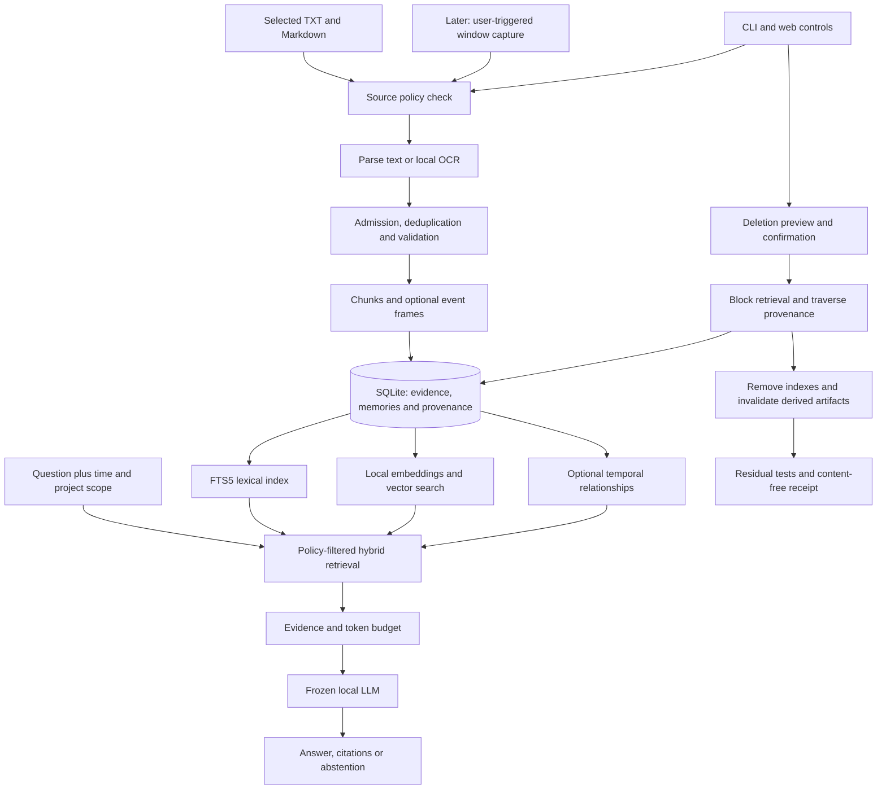
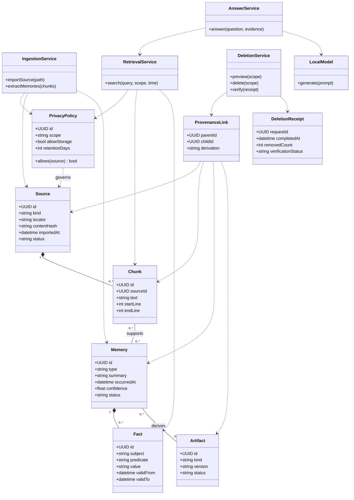

# NeuroBrain: working plan from scratch

> **Updated plan:** The expanded neural-training and session-by-session roadmap is in [NeuroBrain_Session_Plan.md](NeuroBrain_Session_Plan.md). It supersedes this document’s schedule and adds a trained admission network. The current implementation uses SQLite locally; the next prototype stage uses Google Drive for original files and Supabase PostgreSQL for cloud evidence storage. This earlier document remains architectural background.

Prepared 27 October 2026. Status: proposed implementation plan; no application has been implemented by this planning task.

## 1. Goal and decisions carried forward

Build a local personal memory assistant that imports selected notes, remembers their evidence and time, answers questions with citations, handles changed facts, and lets the user remove memories and their derived artifacts. Then extend the same pipeline to explicitly requested screen observations.

The first deliverable is a working memory system around a frozen pretrained language model. Memory grows in a database; model weights stay unchanged. “From scratch” means building the application and evaluation, not training a foundation model.

### Evidence reviewed

All three accessible chats belonging to the NeuroBrain project were reviewed, plus the current request:

| Chat | Contribution to this plan |
|---|---|
| Audit project and research alignment, 16 October | Narrow notes/Markdown scope; memory + deletion; CLI + web; solo intermediate developer; 8–16 GB laptop; 6–10 hours/week; 6–8 week aspiration. Earlier pause remains a boundary against starting implementation in this planning task. |
| Summarize research papers, 16 October | Structured episodic memory, temporal relations, provenance, selective admission, measurable retrieval and deletion; parametric adaptation is later research. |
| Analyze Clicky with REA, 27 October | Future screen capture and understanding; public Clicky and installed version differ; local installation is not proof of offline inference; REA repair reported complete, deeper installed-app data-flow analysis remains unfinished. |
| Plan NeuroBrain from scratch, 27 October | Consolidate the chats into a complete working plan with datasets and OOM diagram. |

Local sources reviewed: `NEUROBRAIN.md`, `NeuroBrain_22_Paper_Literature_Review.md`, `ResearchPaper.md`, and the reading-list inventory. The two review Markdown files currently contain the same report. The directory has proposal/research material, not a runnable application. The original blueprint stops at its architecture heading. This plan supplements it without overwriting it.

Coverage means all project-member chats exposed by the current chat listing; it does not imply access to deleted chats or every unrelated ChatGPT conversation. Historical hardware/time preferences are planning assumptions, not a fresh hardware benchmark.

### Scope ladder

| Stage | Included | Release condition |
|---|---|---|
| Core MVP | Manually selected `.txt`/`.md`, source citations, lexical/vector/hybrid search, fact history, deletion, CLI and small web UI | Functional and deletion gates below pass |
| Research extension | Event extraction, limited temporal graph, selective admission and consolidation | Beat or explain comparison with simpler retrieval |
| Screen extension | User-triggered window capture, local text extraction, optional local vision, preview and save | Privacy and screen evaluation gates pass |
| Later work | PDF parsing, approved workspace watchers, voice, workflow suggestions, reviewed macros, isolated adapters | Separate feasibility and safety experiments |

Continuous screen recording, global keylogging, silent command-history ingestion, autonomous script execution, Titans/Mamba training, federated learning and weight unlearning are outside the first release. The original vision remains a roadmap; do not claim those capabilities in the demonstration.

## 2. What a successful demonstration looks like

1. Import three selected project notes. Show filenames, timestamps, chunks and import status.
2. Ask “What database did I choose?” Receive an answer with a clickable file and passage reference.
3. Add a newer note changing the decision. Current questions use the newer valid fact; “what did I choose before?” can retrieve the old version.
4. Ask an unsupported question. The assistant says evidence is insufficient.
5. Preview “forget this note.” Show the number of dependent records and artifacts.
6. Confirm deletion. Repeat exact, paraphrased and related queries: removed evidence cannot be retrieved or cited. Unrelated notes still work.
7. Restart the application and repeat the deletion checks.
8. Optional later demo: capture a synthetic editor window, preview the extracted observation, save it as a memory, then retrieve and delete it.

## 3. Architecture and module responsibilities



| Module | Responsibility | Failure behavior |
|---|---|---|
| Source adapters | Validate allowed files, parse text, retain line offsets and hashes | Reject unsupported type, oversized input and paths outside selected roots |
| Policy service | Source allowlist, exclusion, retention and query authorization | Fail closed; policy decisions cannot be overridden by the LLM |
| Ingestion service | Normalize, deduplicate, chunk, validate and commit | Roll back failed imports; retry by stable job/source version |
| Memory service | Store evidence, events, time and versioned facts | Preserve source evidence when extraction is uncertain |
| Retrieval service | Filter, combine lexical/vector results and optionally expand graph | Use lexical fallback if embeddings fail |
| Answer service | Fit evidence to context, call local model, validate citations | Evidence-only response if model unavailable; abstain if unsupported |
| Deletion service | Traverse dependency graph, block access, purge and verify | Keep affected IDs unavailable until cleanup is complete |
| Interface | Import, search, ask, inspect, correct, delete and policy controls | Show useful status without raw private data in error logs |
| Evaluation runner | Reproducible data adapters, baselines, metrics and reports | Record failures/timeouts; never silently drop difficult questions |

Use one shared Python service layer from both CLI and API. Do not duplicate ingestion/deletion logic in each interface. Database writes use transactions and foreign keys. External files and in-memory indexes require a durable cleanup job because a SQLite transaction cannot atomically delete files or reset another process's cache.

## 4. OOM diagram: object-oriented model

“OOM” is interpreted here as Object-Oriented Model. This UML class diagram describes the proposed objects and relationships. Composition indicates application-owned child records; dependency arrows indicate service use. The separate architecture diagram describes processing flow.



`Artifact` covers embeddings, summaries, answer caches and future skills; all record their input dependencies. A memory can cite multiple chunks, and a chunk can support multiple memories. Do not encode provenance as a single source field if consolidation combines sources.

## 5. Data model and lifecycle

Proposed SQLite tables:

- `sources`: ID, source kind, selected path, content hash, version, import time, policy, status.
- `chunks`: source version, text, offsets, chunker version; FTS5 index keyed by chunk ID.
- `memories`: type, event text, event time, observed time, project, confidence, sensitivity and status.
- `memory_evidence`: many-to-many memory/chunk links with evidence spans.
- `facts`: subject, predicate, value, valid-from/to, confidence and supporting memory.
- `relations`: typed links such as `precedes`, `supersedes`, `corrects`, `related_to`; each link has evidence.
- `artifacts` and `artifact_dependencies`: every embedding/summary/cache artifact and its complete parent set.
- `embeddings`: chunk/memory ID, model revision, vector dimensions and float32 vector.
- `policies`, `jobs`, `deletion_requests`, `deletion_receipts`: controls, recovery and content-free audit.

Distinguish event time from import time. Interpret historical questions relative to the requested time. “Latest imported” is insufficient for selecting current truth. A correction, a preference change and two facts valid in different contexts need different relations.

Example: a 1 October note says “SQLite”; a 15 October note says “changed to PostgreSQL.” Preserve both with validity intervals. A note imported on 20 October describing September must not overwrite the October decision solely because it arrived later.

Manual edits create a new source version and invalidate dependent artifacts. Re-importing identical content should be idempotent. For a small MVP, a deterministic parser plus raw chunks is enough; LLM event extraction is an optional enrichment with schema validation and an inspect/correct screen.

### Retrieval algorithm

1. Apply source, policy, deletion status, project and time filters before any evidence reaches the model.
2. Retrieve lexical and vector candidates independently; merge using reciprocal rank fusion. Start with 20 candidates per method and keep five evidence chunks, adjusting on development data only.
3. Optional graph expansion follows at most one hop and adds at most five evidence items; never bypass the same filters.
4. Deduplicate overlapping evidence, preserve offsets, and fit the context budget.
5. Ask the model to answer only supported claims and cite evidence IDs. Validate that emitted IDs were supplied. Manually sample whether the cited passages actually support claims.
6. Low similarity is only one abstention signal. Calibrate an evidence-sufficiency rule on answerable/unanswerable development questions.

These numbers are initial settings, not proven optimums. Use normalized cosine similarity for vectors. Begin with a recent-context buffer and explicit rules; a buffer is not a Mamba implementation and retrieval-time adaptation is not neural test-time training.

## 6. Technology and machine budget

| Layer | Proposed first choice | Reason |
|---|---|---|
| Application | Python 3.11 or 3.12, isolated environment, pinned lockfile | One language for services and evaluation |
| Persistence | SQLite + foreign keys + FTS5; WAL if supported by deployment | Small local dependency footprint |
| Embeddings | `sentence-transformers/all-MiniLM-L6-v2`, pinned revision | 384-dimensional English baseline; test multilingual alternatives only if required |
| Similarity | NumPy cosine search over a bounded corpus | Simple to inspect, rebuild and delete |
| Generation | A locally hosted quantized Qwen3-4B candidate; smaller local model if needed | Frozen pretrained generator; model choice decided by measurements |
| Runtime | Ollama with explicit local model and loopback endpoint | Separate inference from application logic |
| Interfaces | Typer CLI; FastAPI + server-rendered HTML and small JavaScript | Avoid a second large frontend stack |
| Verification | pytest, Ruff, repeatable evaluation runner | Lifecycle correctness plus measured quality |
| Screen later | macOS window capture and local OCR behind adapters | Reuse the same ingestion and deletion contract |

Candidate sources: [Qwen3-4B model card](https://huggingface.co/Qwen/Qwen3-4B), [MiniLM model card](https://huggingface.co/sentence-transformers/all-MiniLM-L6-v2), [Ollama quickstart](https://docs.ollama.com/quickstart), [SQLite FTS5](https://www.sqlite.org/fts5.html). Pin the exact runtime/model artifact and quantization; the model card does not by itself identify an Ollama tag or guarantee laptop performance.

For 8 GB RAM, first prove lexical retrieval, then embeddings; run a small generator with a short context and one request at a time. For 16 GB, trial a 4B quantized generator with a bounded context. These are feasibility candidates, not hardware guarantees. Measure total process memory including embedding runtime, model and KV cache. Keep a retrieval-only mode if generation is too slow.

Raw vector storage for 10,000 chunks at 384 float32 dimensions is about 15.4 MB before database/index overhead; neural runtime memory is separate. Limit embedding inputs to the embedding model's supported length—use about 150–200 tokens initially for MiniLM and verify tokenization rather than silently truncating long passages. Preserve headings and source spans across overlap. No dedicated vector database, graph server, Redis or GPU is required for the first prototype.

## 7. Datasets: exactly what to collect and why

The MVP uses pretrained models without fine-tuning. It needs an input corpus, development questions, frozen evaluation questions and deletion cases. Public benchmarks evaluate memory; they are not NeuroBrain training data.

| Dataset | Use | Initial size and split | Obtain from |
|---|---|---|---|
| NeuroBrain Notes v0, to create | End-to-end note ingestion, recall, changing facts and citations | 100 fictional notes across 20 independent project/persona scenarios, five notes each; 10 scenarios dev and 10 test | Author locally using templates below |
| NeuroBrain QA v0, to annotate | Answer quality and retrieval ground truth | 200 questions: 100 dev, 100 test; 20 per category in each split | Human-authored questions over Notes v0 |
| NeuroBrain Deletion v0, to create | Exact deletion, dependent artifacts and retained utility | 40 independent scenarios: 20 dev, 20 held-out; each has target facts, retained facts, paraphrases and derivations | Fictional facts and unique synthetic canaries |
| LongMemEval-S cleaned | External long-term memory validation | Start with fixed 50 dev + 50 test questions; stratify by type and group overlapping histories; later full 500 if time permits | [Official repository](https://github.com/xiaowu0162/LongMemEval), [cleaned dataset](https://huggingface.co/datasets/xiaowu0162/longmemeval-cleaned) |
| LoCoMo | Independent long-dialogue check | Two conversations for adapter/dev; remaining eight held out; start with text only | [Official repository](https://github.com/snap-research/locomo), `data/locomo10.json` |
| NeuroBrain Screen v0, later | Screen-to-observation-to-memory evaluation | 100 synthetic/mock or consented screenshots from 20 task sessions; 10 sessions dev, 10 test | Locally staged apps with fictional contents |
| ScreenSpot-Pro, optional later | Pointing/GUI element grounding only | Fixed 100-item evaluation subset if pointing is implemented | [Author repository](https://github.com/likaixin2000/ScreenSpot-Pro-GUI-Grounding) |

LongMemEval exposes five memory abilities and 500 questions; use `longmemeval_s_cleaned.json` for the initial adapter. The oracle file is a diagnostic upper bound, not a normal retrieval result. The repository now points to V2 too; freeze the cleaned v1 protocol for comparability and list V2 as a separate future evaluation. [Official benchmark instructions](https://github.com/xiaowu0162/LongMemEval)

LoCoMo supplies ten annotated conversations and evidence dialog IDs. Its original images are not released; text/captions do not turn it into a screen-understanding benchmark. [Official dataset description](https://github.com/snap-research/locomo)

ScreenSpot-Pro tests locating GUI targets. It cannot establish long-term memory quality, general screen comprehension or privacy compliance. Select it only if coordinate pointing becomes a feature. [Author repository](https://github.com/likaixin2000/ScreenSpot-Pro-GUI-Grounding)

### Build the custom corpus

For each fictional scenario, write five dated notes: initial plan, progress, changed decision, retrospective and a distractor. Vary names and facts across scenarios. Include explicit corrections, historical decisions, same-name entities in different projects, relative dates, duplicated notes, conflicting evidence and irrelevant passages. Never use genuine credentials or private screenshots as test canaries.

QA categories, equally represented in both 100-question splits:

1. Direct factual lookup.
2. Multi-note synthesis.
3. Time-sensitive/history lookup.
4. Updated/conflicting facts.
5. Unsupported question requiring abstention.

Each QA record stores `id`, `scenario_id`, `split`, `question`, `question_time`, `category`, `acceptable_answers`, `evidence_ids`, `required_fact_ids` and `answerable`. Keep gold answers and evidence labels outside ingestion. Public benchmark adapters ingest only histories, not QA answers or evidence annotations. Treat each benchmark history as its own memory namespace; do not mix unrelated simulated users.

For deletion scenarios, insert a unique fictional value, two paraphrases, one derived summary, one relation and one cached answer; include at least two unrelated retained facts. Cover deletion by source, memory, date range and project. Check graph neighbors and multi-parent summaries, not only exact target strings.

### Dataset governance and reproducibility

Create `data/manifest.json` with upstream URL/revision, SHA-256, date obtained, license or unresolved rights status, local filename, adapter version, split rule/seed and selected IDs. Verify dataset-specific terms before redistributing; repository software licensing need not cover every data asset. Do not invent a license for an insufficiently documented source.

Split by scenario/conversation before generating paraphrases. Remove or group identical/near-identical histories across partitions. Freeze test IDs and prompt settings before comparisons. A full benchmark rerun after tuning on it must be labeled exploratory. Human review should check all 200 custom questions and their source spans; small subsets are pilot results, not leaderboard-equivalent claims.

No datasets are downloaded or fabricated as completed assets in this planning task. Above sizes are construction targets. Dataset acquisition, annotation and validation are scheduled implementation work.

## 8. Deletion and privacy contract

Policy applies before persisting content, before embedding/model calls, during retrieval and during export. User exclusions override salience scores. Retrieved text is untrusted evidence; embedded instructions must not change policy or call tools.

Deletion procedure:

1. Preview scope, retained/removed counts and all reachable dependent artifacts.
2. On confirmation, commit a blocked/tombstoned state so concurrent queries cannot retrieve affected IDs. Attach a policy/index generation to running requests and discard answers whose evidence was deleted before delivery.
3. Traverse provenance. Delete owned raw copies, chunks, vectors, facts and relation evidence. Remove source contributions to multi-parent artifacts; recompute them from retained evidence or discard them.
4. Purge FTS entries and vector snapshots; invalidate summaries, caches, exports under app control and future skill artifacts. All summary dependencies must be explicit, including dependencies on previous summaries.
5. Finish durable file cleanup jobs; resume after crash. Clear working buffers and invalidate affected in-flight generations. Rebuild index snapshots from live authorized rows.
6. Run exact/paraphrased/related retrieval probes and retained-fact checks; restart and repeat. A job is complete only when cleanup and verification finish.
7. Store a receipt with request ID, counts, time and pass/fail status, avoiding deleted text, revealing filenames and content hashes that could identify the forgotten fact.

“Forget” removes application-controlled memory and its descendants. Original user-owned files stay unchanged unless explicitly separately selected for deletion. Keep a suppression marker outside retrieval so a watcher cannot silently re-import a forgotten source; disclose that this minimal marker is retained and allow its removal when the user wants re-import.

SQLite free pages, WAL files, backups and SSD behavior mean logical deletion is not a forensic-erasure guarantee. Define backup expiry, WAL/checkpoint handling and recovery behavior explicitly; restorations must reapply deletion records before queries run. Avoid promising “absolute erasure.” A model may already know a public fact, so judge deletion by access to removed evidence and synthetic private canaries, not failure to answer arbitrary public knowledge.

No private-data weight training in v1 means this is external-memory deletion, not machine unlearning. Local-only operation also needs verification: pre-download weights, choose local endpoints, disable telemetry/remote fallbacks, then test normal workflows with network access blocked.

## 9. Implementation schedule and effort

Assumption carried from earlier chat: solo developer, 6–10 hours/week. Eight weeks provides 48–80 hours. Reserve an approximately 60-hour core; graph/screen extensions require additional weeks. If foundational Python is new rather than revision, add a learning phase instead of fitting an entire beginner course into this budget.

| Week | Work and dependency | Planned hours | Demonstrable exit condition |
|---|---|---:|---|
| 1 | Confirm machine; initialize repo/environment; basic SQLite schema; define manifest and fictional corpus | 7 | Clean install instructions, ten notes and ten labeled questions; rollback/dedup smoke test |
| 2 | TXT/MD adapter, offsets, policy checks, import jobs, FTS5 and CLI | 8 | Import selected folder, reject excluded files, cite exact passages and re-import without duplication |
| 3 | Local embeddings, vector baseline, hybrid retrieval, evidence budget | 8 | Reproducible lexical/vector/hybrid comparison on dev; model-free search still works |
| 4 | Frozen local LLM, cited answers, abstention and simple temporal facts | 8 | Ten example questions with validated citation IDs; current vs historical question demo |
| 5 | Provenance dependencies, transactional blocking, purge jobs, crash recovery and deletion probes | 10 | All 40 custom deletion scenarios structurally validated; held-out results recorded separately |
| 6 | Small web dashboard using shared services; policy/source/history/deletion views | 7 | Full demo possible through CLI and web; local-only binding and recovery checks |
| 7 | Complete custom annotations; external adapters; freeze and run held-out comparisons | 7 | Metrics with denominators, failures, hardware and dataset versions; no test-guided tuning |
| 8 | Fix gate failures, reproduce setup, report, diagrams, slides and demo recording | 5 | Repeatable release demo and honest limitations |
| Extension A | Event frames, selective admission, one-hop temporal graph and consolidation | +12–20 | Controlled ablation improves quality or explains cost/tradeoff |
| Extension B | Window capture, local OCR, preview/save, screen dataset | +15–25 | Screen gates pass; no automatic background recording |
| Extension C | Local vision feasibility, pointing/voice/workflow suggestions | Separate estimate | Feature-specific dataset, machine budget and permission design approved |

If the deadline contracts to six weeks, ship notes + lexical/vector search + citations + deletion + minimal UI; reduce public benchmark scale and defer model-based event extraction, graph traversal and all screen work. Reduce feature breadth before cutting deletion correctness. If hours rise above 80, extend the schedule rather than pretending the graph/screen system fits the core estimate.

### First three development sessions

- Session 1, 2 hours: record CPU/OS/RAM/free disk, create isolated Python environment and version control; load ten fictional notes; agree on one end-to-end scenario.
- Session 2, 2–3 hours: source/chunk schema, allowed-path checks, stable IDs, import and lexical search with line citations.
- Session 3, 2–3 hours: delete a source, verify FTS cleanup and repeat queries after restart. Then add embeddings to a lifecycle that already works.

Proposed repository layout:

```text
src/neurobrain/
  adapters/       # Markdown/text now; screen and PDF later
  policy/         # admission, scope and retention
  ingestion/      # chunking, extraction and idempotent jobs
  memory/         # records, facts, provenance and consolidation
  retrieval/      # lexical, vector, fusion and graph
  generation/     # local model boundary and citations
  deletion/       # preview, closure, cleanup and verification
  interfaces/     # CLI, API and templates
  storage/        # schema, migrations and repositories
  evaluation/     # adapters, baselines and metrics
tests/
data/            # private/raw assets excluded from version control
docs/
reports/
```

Proposed commands, to implement: `neurobrain import`, `search`, `ask`, `inspect`, `forget --preview`, `forget --confirm`, `policy`, `evaluate`, `serve`. API equivalents: import jobs, search, ask, source/memory inspection, policy updates, deletion preview and deletion request status. Mutations use validated IDs and explicit scope. Bind the web app to loopback, reject cross-origin mutation requests, restrict file serving to registered sources and use safe rendering for imported Markdown.

## 10. Evaluation: baselines, metrics and gates

Run the same generator, prompt, retrieval budget, corpus and hardware across comparisons. Ingest each scenario chronologically. Record ingestion cost separately from query latency. Keep gold annotations unavailable to the assistant.

Baselines: B0 no external memory; B1 FTS5; B2 vector-only; B3 hybrid lexical/vector; B4 hybrid + temporal metadata; B5 optional event frames/graph. Full-context/oracle is a diagnostic only when it fits; report truncation and privileged evidence clearly. Compare graph on/off, admission on/off, raw chunks/event frames and consolidation on/off one change at a time.

| Measure | Definition | Proposed release gate |
|---|---|---|
| Evidence retrieval | Recall@5 of gold evidence units; all-required-evidence rate for multi-note questions | Custom answerable test Recall@5 at least 0.85 |
| Answer quality | Rubric correctness and token F1 where appropriate; per-category breakdown | Custom answerable test correctness at least 0.80 |
| Citation support | Supported cited claims / evaluated cited claims | At least 0.95, with sample count |
| Abstention | Correct abstentions / unanswerable cases; also false abstention on answerable cases | At least 0.90 on custom unsupported questions; report false abstention |
| Deletion correctness | Deleted descendants absent from all accessible stores/indexes/caches and after restart | 100% lifecycle checks on frozen deletion suite |
| Residual evidence | Exact/paraphrased/neighbor probes retrieve deleted evidence or canary | Zero on defined suite; not a universal privacy proof |
| Retained utility | Retained QA correctness before/after deletion | No more than five percentage points drop on unaffected cases |
| Local runtime | Retrieval p50/p95; TTFT, tokens/sec; peak app+model RAM; storage | Initial retrieval p95 target below one second at 10k chunks; set generator latency budget after week-1 device trial |
| Offline operation | Import, embed, ask, inspect, delete with external network blocked | All core flows pass once weights are cached |

All thresholds are proposed engineering goals, not existing results or borrowed paper scores. The five-point retained-utility margin is coarse on small sets: report paired counts and confidence intervals rather than overstating significance. Public benchmark results have no promised pass score; report each protocol and subset size. If hybrid/graph does not improve the fixed baseline, ship the simpler method and explain the negative result.

Use blinded human review for the custom set, with independent second review of a sample if available; otherwise disclose single-rater judgment. If using a local LLM judge, validate agreement against human scoring and report disagreement. Do not silently substitute it for the original benchmark evaluator or send personal examples to a cloud judge.

Lifecycle tests should cover import interruption, unsupported encoding, duplicates, changed content, source removal, summary dependencies, concurrent query/deletion, crash mid-cleanup, malicious note instructions, model outage, index rebuild and restored backups. Failed queries remain in result denominators. Measure cold and warm latency with dataset/model revision, quantization, context length and RAM recorded.

## 11. Screen extension informed by Clicky

The earlier investigation established a public screen-question pipeline and reported a newer installed app with different resources. The public README explicitly says newer development is private and documents cloud API dependencies. Do not assume the installed app shares every public behavior. [Clicky source and setup](https://github.com/farzaa/clicky)

NeuroBrain's proposed local flow:

1. User invokes “capture current window”; pre-capture app/window allowlist prevents prohibited captures.
2. Capture only the chosen window; retain dimensions, scale, monitor and timestamp transiently.
3. Extract visible text locally and optionally read permitted accessibility text. Redact sensitive regions before any persistence; OCR-based redaction is imperfect, so source exclusion and preview remain necessary.
4. Show extracted text and a bounded description; user decides whether to save. Raw screenshots default to transient use and are removed after processing unless explicitly retained.
5. Store an observation such as “terminal displays error X.” Treat “user is debugging authentication” as an inference with confidence and evidence, not an observed fact.
6. Feed accepted observations into the existing provenance/deletion pipeline.

For Screen v0 annotate app/window, OCR ground truth, visible events, sensitive regions, memory-worthy label and expected abstention. Measure OCR character error rate, observation precision, admission precision/recall, sensitive-region recall, latency and downstream memory answers. Treat every known unredacted synthetic secret in the test suite as a release blocker. Add two-monitor/high-DPI/coordinate tests only if pointing is built.

A vision-language model must be benchmarked separately on the target laptop. Start with local OCR for text-heavy screens; it does not understand diagrams or all layouts. Do not load a second large model merely to imitate Clicky's presentation. No Clicky training dataset has been established; live screenshots are inference inputs, not evidence of custom training. Completing installed-version REA analysis is a separate research task, not a dependency for building notes memory.

## 12. Study path tied to build artifacts

Use selected chapters/lectures while building, not several full courses before starting.

| Order | Learn | Source | Practice output |
|---|---|---|---|
| 1 | Python functions, errors, files, tests and classes | [Harvard CS50P videos and exercises](https://cs50.harvard.edu/python/) | Read a Markdown file, validate it and write a tested parser |
| 2 | Practical file processing and automation | [Automate the Boring Stuff with Python, free book](https://automatetheboringstuff.com/) | Allowed-folder importer with clear errors |
| 3 | Tables, foreign keys, transactions and search | [SQLite FTS5 documentation](https://www.sqlite.org/fts5.html) | Notes search plus transactional deletion |
| 4 | Embeddings, cosine similarity and retrieval | [Sentence Transformers semantic search guide](https://www.sbert.net/examples/sentence_transformer/applications/semantic-search/README.html) | Compare lexical and semantic top-five results |
| 5 | Local model serving and context budgets | [Ollama quickstart](https://docs.ollama.com/quickstart), model cards linked above | Answer from five passages with valid citations |
| 6 | Request validation, API design and templates | [FastAPI tutorial](https://fastapi.tiangolo.com/tutorial/) | Web import/search/deletion controls sharing CLI services |
| 7 | Experimental design and memory research | Local 22-paper review, then LongMemEval/LoCoMo official evaluators | Frozen dataset manifest, baseline table and error analysis |

CS50P provides its own YouTube links. It is the initial video-course recommendation; use the official page to choose the current playlist. Learn graph basics through nodes, edges, traversal and time intervals when adding relations; implementing a graph database or graph neural network is unnecessary here.

Research reading sequence from the existing review: SEEM for event frames/provenance; EMA for admission; RMM for consolidation; DYNA and the graph-memory survey for temporal links; on-device papers for resource measurements; PrivUB for the principle of multi-probe privacy evaluation. This plan reuses the existing review's synthesis; it does not claim to have reverified every publication date or reproduced its numbers. Papers 10/11 are one evolving manuscript, not two independent findings. Resolve questionable original-blueprint citations before academic submission.

## 13. Academic framing, deliverables and risks

Suggested title: **NeuroBrain: A Local Personal Memory Assistant with Temporal Retrieval and Provenance-Aware Deletion**. Retain the broader neural-memory vision as future work unless neural adaptation is actually implemented and evaluated.

Research questions:

- Does hybrid retrieval improve source-grounded note recall over lexical/vector baselines?
- Does temporal metadata improve changed-fact and historical answers?
- Can provenance-aware deletion remove reachable evidence while preserving unrelated utility?
- Optional: do event frames/graph expansion justify their extraction and latency cost?

Contribution is an implemented, measured lifecycle and reproducible evaluation. Combining established components alone does not prove a novel algorithm. Negative results and failure categories are useful findings.

Final artifacts: installable application; dependency/model lock information; architecture and OOM diagrams; schema and API/CLI guide; custom corpus and annotation instructions; public dataset manifests; benchmark runner; result tables with counts and hardware; deletion receipts and failure examples; privacy/retention statement; project report; presentation and five-minute demo. Publish only fictional/redistributable assets.

| Risk | Early response |
|---|---|
| Small model produces unsupported facts | Keep evidence mode, bounded context, citation checks and abstention |
| Graph extraction errors compound | Preserve raw evidence; validate confidence; rebuild and compare simpler baseline |
| Fine-tuning makes forgetting hard | Freeze weights throughout v1 |
| Deleted content survives summaries/caches | Dependency closure, invalidation, restart probes and durable jobs |
| Dataset leakage inflates scores | Group splits and hide gold annotations; freeze held-out IDs |
| Screen collection expands beyond consent | User trigger, source exclusion, local preview and default raw-image expiry |
| Resource limits or slow inference | Smaller generator, shorter context, one request; retrieval-only fallback |
| Deadline pressure | Ship correct memory/deletion first; move graph and screen to extensions |

## 14. Planning quality check

Self-evaluation using the agent-self-evaluation rubric: overall 4.2/5.

| Axis | Score | Evidence and improvement |
|---|---:|---|
| Accuracy | 4 | Project chats and official benchmark/model sources checked; hardware and library compatibility still require week-1 experiments. |
| Completeness | 4 | Includes setup, datasets, schedule, objects, interfaces, deletion, evaluation and screen roadmap; deleted/inaccessible chats cannot be recovered through current listing. |
| Clarity | 4 | Separates core and extensions and defines OOM; detailed reference document benefits from the shorter chat overview. |
| Actionability | 5 | Week-by-week exits, first sessions, explicit data construction and measurable release criteria are specified. |
| Conciseness | 4 | Depth matches “everything from scratch”; some architecture/privacy concepts recur because each section must be usable independently. |

No critical score at or below two. Next improvements: measure the target machine, lock actual dependency/model revisions during implementation, and replace planning targets with recorded benchmark results. Self-check: this is useful as a build reference, while the chat overview should remain short. Verdict: deliver the plan with these experimental limits visible.
