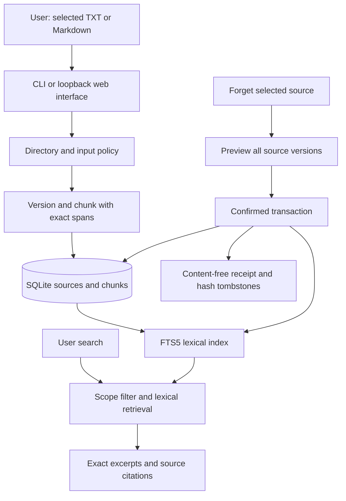
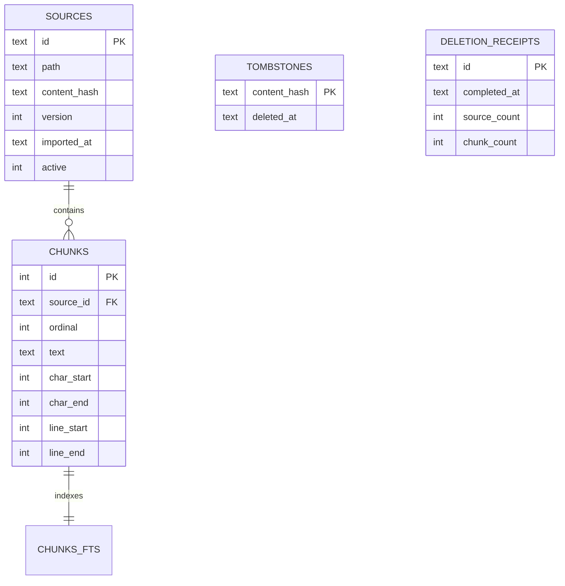

# NeuroBrain system design — implementation checkpoint v0.1

**Date:** 27 October 2026; cloud direction updated 2 November 2026. **Purpose:** present the working local baseline and the next cloud prototype without confusing planned components with implemented ones.

## 1. Charter

Help a user recall facts from selected local notes with inspectable source evidence, and remove saved sources deliberately. The demonstration uses fictional notes only. The first checkpoint must run without downloading a model or sending content to an external service.

The full research project adds a supervised neural memory-admission head to reduce unnecessary retention. Its encoder and local generator stay frozen. Private user notes are inference data, never training examples. The research questions and acceptance targets in `NeuroBrain_Session_Plan.md` remain targets, not results.

## 2. Current implemented architecture



Both interfaces call `MemoryStore`; there is no duplicated browser-only memory implementation. The runtime uses Python's standard library and SQLite FTS5. The plan's FastAPI/Typer stack can replace the initial thin HTTP/CLI adapters later without changing the core contract. This is a deliberate checkpoint choice, not completion of the final interface stack.

| Module | Basic implementation | Code |
|---|---|---|
| Input/privacy policy | Explicit notes directory; TXT/MD; bounded UTF-8 read; excluded/hidden paths and symlinks; do-not-store directive; credential heuristics | `src/neurobrain/core.py`: `NotePolicy` |
| Ingestion | SHA-256 deduplication within a source, source versions, deterministic chunks ≤1,200 characters, exact Unicode character/line offsets | `MemoryStore.import_note` |
| Evidence storage | SQLite FK constraints, active-version uniqueness, schema v1, transactions | `MemoryStore`, `SCHEMA` |
| Retrieval and inspection | FTS5 BM25, literal query tokens, current-version and allowed-directory filtering, evidence IDs | `search`, `inspect`, `sources` |
| Answer interface | Exact quoted evidence; no matching evidence response; no generated claims | `ask` |
| Forgetting | Preview token, all versions of one source, FK cascade, transactional FTS triggers, integrity checks, receipts, exact-content reimport block | `preview_forget`, `forget` |
| User controls | JSON CLI and browser forms/dialog, local binding, per-launch token, host/origin checks, text-safe rendering | `cli.py`, `web.py`, `index.html` |

## 3. Data model and relationships



FTS5 uses external content with insert/delete triggers. Source IDs are UUIDs; evidence citations combine source ID and chunk row ID. Character offsets are half-open Python Unicode string offsets; line numbers are one-based. Chunks are evidence passages in this baseline, not extracted semantic facts.

Importing identical current text at the same path returns its existing ID. Changed text increments the source version and marks previous versions inactive. Search retrieves active versions only; explicit inspection retains history. The import timestamp is not event time. The prototype does not infer current truth between conflicting notes or parse historical validity intervals.

## 4. Deletion sequence and boundary

```mermaid
sequenceDiagram
    actor User
    participant UI as CLI/Web
    participant Store as MemoryStore
    participant DB as SQLite and FTS
    User->>UI: Preview selected source
    UI->>Store: preview_forget(source_id)
    Store->>DB: Read all versions and dependent chunks
    Store-->>User: Counts, boundary, preview token
    User->>UI: Confirm preview token
    UI->>Store: forget(source_id, token)
    Store->>DB: BEGIN IMMEDIATE; recompute preview
    Store->>DB: Save fingerprints, delete versions and chunks
    DB->>DB: FTS delete triggers
    Store->>DB: Write receipt; check FTS and foreign keys
    Store->>DB: COMMIT (or rollback every change)
    Store-->>User: Verified application deletion receipt
```

Every dependent artifact currently lives in the same SQLite transaction, so a filesystem purge queue is unnecessary at this stage. Once embeddings, summaries, caches, or model requests exist, implement their dependency records, durable purge, and in-flight invalidation before claiming the same lifecycle guarantee. Current tests do not establish future artifact deletion.

The tombstone stores a SHA-256 fingerprint, not raw content. It blocks identical text on future import. It is not a semantic detector: paraphrases, changed text, and overlapping information already in a different source remain outside this source-scoped deletion. There is no weight unlearning. Original files, old database copies, backups, browser memory and displayed/copied excerpts are separate boundaries. Restore suppression is not implemented.

## 5. Interface contract

| Action | CLI command | Local HTTP route |
|---|---|---|
| Import selected note | `import PATH` | `POST /api/import` with relative `path` |
| List source versions | `sources` | `GET /api/sources` |
| Retrieve excerpts | `search QUERY`, `ask QUERY` | `GET /api/search?q=QUERY` |
| Inspect evidence | `inspect SOURCE_ID` | `GET /api/inspect?id=SOURCE_ID` |
| Preview forgetting | `forget SOURCE_ID --preview` | `GET /api/preview?id=SOURCE_ID` |
| Confirm forgetting | `forget SOURCE_ID --confirm TOKEN` | `POST /api/forget` with `id`, `preview_token` |
| Policy/config | `policy` | Fixed baseline explanation in page |

All API requests require the launch token. HTTP errors use JSON with an `error` field. The web server has bounded request bodies and read timeouts; it is for one local user, not a public production API. Note contents render with `textContent` so Markdown/HTML is displayed literally. Source text is never executed or treated as an instruction.

## 6. Next cloud prototype and what remains

The local SQLite/FTS5 implementation above is the verified baseline. The next prototype stage will keep the same service contract while moving storage to Google Drive plus Supabase:

- Google Drive stores original TXT/Markdown files in one user-selected folder.
- Supabase PostgreSQL stores source versions, chunks, citations, tombstones and deletion receipts.
- The application validates downloaded Drive content before writing it to Supabase.
- Row-level security limits cloud records to the signed-in user.

This cloud path is planned, not implemented. SQLite remains the local reference backend until import, search, inspection and deletion have equivalent tests.

## 7. Full proposed neural design and what remains

The existing `NeuroBrain_Architecture.mmd` and `NeuroBrain_OOM.mmd` describe the full proposed system. They are not claims that every box is implemented.

The planned head takes a frozen 384-dimensional MiniLM embedding plus four metadata features, then uses **388 → 128 → 32 → 1**, with ReLU and dropout, totalling **53,953 trainable parameters**. It learns usefulness from fictional, grouped train/validation/test data; deterministic privacy rules always run first. Initial deployment is suggestion mode, with automatic exclusion gated by measured recall and downstream QA quality. No head, dataset, checkpoint, or reported accuracy exists at this checkpoint.

Next additions are the cloud prototype, dataset annotation and split validation, embeddings and hybrid retrieval, neural baselines and MLP training, source-grounded local generation, then temporal facts and richer provenance. Screen capture stays an extension. See the presentation checkpoint for session mapping and priorities.

## 8. Evidence and open limits

See `reports/verification.md` for executed checks. No benchmark QA accuracy, neural recall, 10k-chunk latency, full offline network-block test, encryption, hostile local filesystem race protection, or general privacy proof is claimed. The allowlist checks assume ordinary local use; simultaneous malicious filesystem replacement is outside this demo's threat model.
